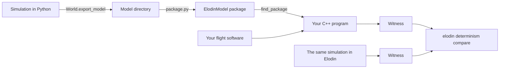

+++
title = "Custom C++ Runtimes"
description = "Export an Elodin simulation as a native library, step it from your own C++ program without Python or Elodin, and prove the two runs match"
draft = false
weight = 106
sort_by = "weight"

[extra]
toc = true
top = false
icon = ""
order = 6
lead = "Compile the simulation you built in Elodin into a native library, run it from your own C++ program, and prove it reproduces the Elodin run byte for byte."
+++

You built and tested a simulation in Elodin, and now it has to run somewhere Elodin does not: a test rig that only runs frozen, reviewed C++; a customer's simulation framework; a contract that says the deliverable is a library and a header with no Python. This page takes the simulation from Elodin into your own C++ program, and shows how to prove the program still computes exactly what Elodin computed.

Two examples carry the walkthrough. [ball-cpp](https://github.com/elodin-sys/elodin/tree/main/examples/ball-cpp) is the smallest case: one body, a C++ loop, and a CSV that matches Elodin bit for bit. [many-agents-cpp](https://github.com/elodin-sys/elodin/tree/main/examples/many-agents-cpp) is a full SITL: 24 agents, C++ flight software, worker threads, and a witness that Elodin's own tools compare byte for byte.

You may not need this. To put flight software in the loop with an Elodin simulation, use [SITL & HITL](/reference/sitl-hitl), which keeps the editor, database and recipes. To step a simulation from Python for batch runs or reinforcement learning, [`World.to_jax`](/reference/python-api/#class-elodin-jaxsim-jaxsim) is enough.

## The Elodin way

- **One model, one compiled step.** The library holds the same Cranelift code Elodin runs in `World.run`, compiled from the same Python. You do not port the physics by hand.
- **A narrow C boundary.** Your program sees components as arrays of bytes, by name, and three verbs: read, write, step. The rest of the interface only describes the model.
- **Your loop, your rules.** Scheduling, I/O, threads and logging belong to your program. The library opens no files or sockets, and its only threads are the step's own workers, when the model was exported with them.
- **Proof, not trust.** Your program can write Elodin's deterministic witness format, so `elodin determinism compare` checks it against the Elodin run tick by tick and names the first byte that differs.

The library is passive. Your class does not inherit from an Elodin type, and the library has no scheduler, clock, callbacks or processes of its own. A class in your framework holds an `elodin::Instance`, writes its inputs, calls one synchronous `step`, and reads its outputs whenever the framework's contract says to.

## What moves and what stays



| In Elodin | In your runtime |
|---|---|
| Systems, run by `World.run` | `libelodin_model`, stepped with `elodin_model_step` |
| `external_control` components a bridge or hook writes | `elodin_model_write` between steps |
| A `post_step` bridge or a `pre_commit` hook | Your exchange code |
| [s10 recipes](/reference/s10) that start and stop flight software | Your process supervision, or none if the flight software is linked in |
| Real-time pacing and the run receipt | Your scheduler and timers |
| Elodin-DB, the editor, sensor cameras | Not included |

The database and editor are not part of the library. To keep watching runs in the editor, have your program write to an Elodin-DB over [gRPC](/reference/grpc-client) or with the C++ headers from [`elodin-db gen-cpp`](/reference/elodin-cli#elodin-db-gen-cpp).

## Export the step

`World.export_model` builds the world for JAX instead of running it, as [`World.to_jax`](/reference/python-api/#class-elodin-jaxsim-jaxsim) does, and writes one tick of it to a directory. The batches you pass as `interfaces` are optional: each becomes a named group of rows that your program reads and writes together.

```python
world, system, agents = build()
agent_rows = world.prepare_batch({
    "position": world.prepare_component("position", agents),
    "command": world.prepare_component("command", agents, access="write"),
})
world.export_model(
    system,
    "build/model",
    simulation_rate=RATE_HZ,
    workers=8,
    interfaces={"agents": agent_rows},
)
```

| File | Contents |
|---|---|
| `step.stablehlo.mlir` | One whole tick, from every component's value to its next value |
| `step.o` | The same tick compiled ahead of time by the Cranelift backend, for the exporting machine |
| `state.bin` | The initial value of every component, as raw little-endian bytes |
| `schema.json` | The model's layout: its time step and tick, typed components and their entities, and optional named row interfaces |
| `model-manifest.json` | The target `step.o` was compiled for, and the SHA-256 and size of each file |

One step is a whole tick, not just the systems: it advances `tick`, carries forward the components no system writes, and puts each output back in its component's place. Your program only swaps buffers.

**Match `workers` to the run you reproduce.** With more than one worker, Elodin traces each `@el.map` system in chunks of two entities so the chunks can run in parallel, and a chunked sum can round differently from a whole-column sum. An export with `workers=8` traces the same way, so its step reproduces `World.run(workers=8)`; pass `workers=1` to reproduce a run without `workers`. Once the step is exported, the number of threads that runs it does not change its results.

## Package the library

```sh
python3 libs/elodin-model/package.py build/model build/ElodinModel
```

[`package.py`](https://github.com/elodin-sys/elodin/blob/main/libs/elodin-model/package.py) builds `libs/elodin-model` around the model with Cargo and lays out a CMake package. It needs a checkout of the Elodin repository, its pinned Rust toolchain and Python 3.11; it is not part of the `elodin` pip package, and does not need it. Package with the same checkout that exported the model.

```text
ElodinModel/
  ElodinModelConfig.cmake
  include/elodin_model.h, elodin_model.hpp, elodin_step_hook.h
  lib/libelodin_model.so   (libelodin_model.dylib on macOS)
  lib/libelodin_model.a
  schema.json, state.bin, step.o, step.stablehlo.mlir
  model-manifest.json, build-manifest.json, runtime-sbom.json
```

The library holds the model, so a program needs only the library at run time. The model's files and the manifests beside it record what was built, from which Elodin revision and toolchain, with a list of the Rust crates in the library.

`--backend` decides how the model's code gets into the library:

| | `aot` (default) | `jit` |
|---|---|---|
| What the library holds | `step.o`, linked in, and the small runtime its calls need | The StableHLO and Elodin's Cranelift compiler |
| When code is generated | When you export, or package with `--cpu` | Once, in `elodin_model_open` |
| Shared library, many-agents model | About 2 MB | About 6 MB |
| CPU | The one `step.o` was compiled for, or with `--cpu generic` any of its architecture | The machine that opens it |
| Worker threads | Yes | No; the step runs on the calling thread |
| Output | None | One line of compiler statistics on stderr at open |

Both run the same Cranelift code and give identical results; the many-agents witness has the same root on either. Choose `aot` when nothing may compile at run time, and `jit` to compile for whichever CPU opens the library.

The machine that packages need not be the one that exported. `step.o` is compiled for one OS and architecture, so for a target unlike your workstation, copy the model directory there and compile the step again from its StableHLO:

```sh
python3 libs/elodin-model/package.py build/model build/ElodinModel --cpu generic
```

`--cpu generic` makes the library run on any CPU of that machine's architecture; `--cpu native` uses that machine's own instruction-set extensions. ball-cpp packages a `generic` library as well, and holds it to the same bit-for-bit check against Elodin.

## Build your program

[`cpp/CMakeLists.txt`](https://github.com/elodin-sys/elodin/blob/main/examples/ball-cpp/cpp/CMakeLists.txt) in ball-cpp needs two lines to use the model:

```cmake
find_package(ElodinModel CONFIG REQUIRED)
target_link_libraries(ball_cpp PRIVATE ElodinModel::shared)
```

Configure with `-DElodinModel_DIR=<package>`. `ElodinModel::shared` is the shared library; `ElodinModel::static` links the model and its runtime into your executable instead.

The shared library's install name is `@rpath/libelodin_model.dylib` on macOS and its soname `libelodin_model.so` on Linux, so give the executable a relative runpath, `@loader_path/../lib` or `$ORIGIN/../lib`, and `install(IMPORTED_RUNTIME_ARTIFACTS ElodinModel::shared)` copies the library next to it. The installed directory can then move.

Without CMake, link the static or the shared library yourself:

```sh
g++ -std=c++17 main.cpp -I ElodinModel/include ElodinModel/lib/libelodin_model.a -lpthread -ldl -lm
g++ -std=c++17 main.cpp -I ElodinModel/include -L ElodinModel/lib -lelodin_model -Wl,-rpath,ElodinModel/lib
```

The core of ball-cpp's `main.cpp`, without its error checks:

```cpp
ElodinModelProgram* program = elodin_model_open();
ElodinModelInstance* ball = elodin_model_create(program);

// -1 when the model has no such component
const auto world_pos = static_cast<size_t>(elodin_model_component_index(program, "world_pos"));
double pos[7];
for (long tick = 0; tick < ticks; ++tick) {
    elodin_model_step(ball);
    elodin_model_read(ball, world_pos, pos, sizeof pos);
}

elodin_model_destroy(ball);
elodin_model_close(program);
```

## The C interface

[`elodin_model.h`](https://github.com/elodin-sys/elodin/blob/main/libs/elodin-model/include/elodin_model.h) separates a **program**, the model's code and initial state, from **instances**, one run each. Instances of one program are independent, and a program must outlive its instances.

Every function's name starts with `elodin_model_`, left out of this table, and the header documents each one:

| Group | Functions |
|---|---|
| Lifecycle | `open`, `close`, `create`, `destroy`, `reset` |
| The model | `abi_version`, `schema_abi`, `format`, `endianness`, `backend`, `build_info`, `nominal_time_step`, `tick_advanced_by_step` |
| Components | `component_count`, `component_index`, `component_name`, `component_size`, `component_type` |
| Entities | `component_rows`, `entity_id`, `entity_name` |
| Stepping | `step`, `set_time_step`, `current_tick`, `generation` |
| Reading and writing | `read`, `write`, `read_rows`, `write_rows` |
| Named interfaces | `interface_count`, `interface_index`, `interface_name`, `interface_rows`, `interface_field_count`, `interface_field`, `interface_read`, `interface_write` |
| Threads | `set_workers`, `effective_workers`, `recommended_stack` |
| Errors | `error` |

- **Components** are addressed by index, in `schema.json` order. Each holds every entity's value as one little-endian array; read and write it whole, with exactly `elodin_model_component_size` bytes, or by rows. A wrong size fails and copies nothing.
- **Rows** are entities. Row `r` of a component belongs to `elodin_model_entity_id(program, c, r)`, the same id the entity has in Elodin. Use it to find an agent's row instead of assuming an order.
- **Writes** take effect at the next step, like an `external_control` write in Elodin. Write commands after a step and before the next.
- **Named interfaces** are optional prepared batches exported by the model author. They gather selected entity rows under stable aliases and access directions; they do not run callbacks or choose when a caller uses them.
- **Time belongs to the caller.** `elodin_model_step` advances one model transition synchronously; it does not sleep or read wall time. `elodin_model_nominal_time_step` is the step the model starts with, which Elodin keeps in whole nanoseconds: a 120 Hz model reports 0.008333333 s. A model whose systems read the time step at run time, as `el.six_dof` does, has a time-step component that `elodin_model_set_time_step` writes; other models keep the step they were built with, and the call fails. `elodin_model_current_tick` likewise needs a model with a tick component.
- **Reset** restores the embedded initial state. A long-lived application can reset, write case parameters and initial conditions, and run another case without reopening the program.
- **Errors.** Functions return `NULL`, `-1` or nonzero on failure, and `elodin_model_error()` says why. The message is per thread and lasts until that thread's next failure; successful calls leave it alone.
- **Threads.** Use each instance from one thread at a time. Different instances can step on different threads at once; with `jit`, their steps take turns. `elodin_model_set_workers(n)`, before the first `elodin_model_open`, sets how many threads, the caller included, run an `aot` step's parallel groups; 0 uses the count the model was exported for.

### From C++

[`elodin_model.hpp`](https://github.com/elodin-sys/elodin/blob/main/libs/elodin-model/include/elodin_model.hpp) wraps the same calls for C++17. Your class holds the model as a member: there is no base class to derive from, and nothing calls back. Failures throw `std::runtime_error` with the library's message, and the typed reads and writes check the component's type and allocate nothing.

```cpp
#include "elodin_model.hpp"

class Interceptors {
public:
    // Many cases run in one process: reset, then write this case's inputs.
    void begin_case(const std::vector<double>& positions)
    {
        run_.reset();
        run_.write(position_, positions);
    }

    void update()
    {
        run_.write_interface(agents_, command_, commands_.data(), commands_.size());
        run_.step();
        run_.read(position_, positions_.data(), positions_.size());
    }

private:
    elodin::Program model_;                          // opens the model once
    elodin::Instance run_ { model_ };                // the state of one run
    std::size_t position_ = model_.component("position");
    std::size_t agents_ = model_.interface("agents");
    std::size_t command_ = model_.field(agents_, "command");
    std::vector<double> commands_ = std::vector<double>(3 * model_.rows(position_));
    std::vector<double> positions_ = commands_;
};
```

## Run the loop yourself

Elodin's tick loop is short, and your program owns it now. many-agents-cpp keeps Elodin's order, which is what makes byte-for-byte comparison possible:

1. Step the simulation.
2. Read what the flight software needs.
3. Exchange with the flight software, and write its commands.
4. Record what changed.
5. Wait for the next tick, when paced.

A command written at tick N is used by the step at tick N+1, as in Elodin. The heart of [many-agents-cpp's `main.cpp`](https://github.com/elodin-sys/elodin/blob/main/examples/many-agents-cpp/cpp/main.cpp), abridged:

```cpp
for (uint64_t tick = 0; tick < ticks; ++tick) {
    simulation.step();
    const Column position = column(c.position, 3), velocity = column(c.velocity, 3);
    // ... the other components the flight software reads

    // ... pack each agent's state packet into `states`
    exchange->run(states.data(), replies.data());   // in-process, or UDP to processes
    // ... check each reply's magic, version and tick, and copy its command into `command`
    simulation.write_interface(agent_interface, command_field, command);

    // ... record the tick in the witness and the CSV
    pacer.wait();   // sleep to the next 1 ms deadline when real time
}
```

Pacing is yours to choose. The example sleeps to fixed 1 ms deadlines, counts a tick that ends after its deadline as late, and restarts the schedule after a tick more than two periods late, as Elodin's pacing does.

## Flight software in your runtime

The flight software can live in the same process, called once per tick, or run as one process per agent over UDP, as Elodin's recipes run it. many-agents-cpp does both behind one interface, and its witness is the same either way.

**Test the C++ flight software inside Elodin first.** Give it the command-line and packet interface of the flight software it replaces, and it drops into the unchanged Elodin SITL:

```sh
ELODIN_MANY_AGENT_CONTROLLER_BIN=build/install/bin/many_agents_fsw \
  elodin run examples/many-agents/main.py
```

If that run's witness root equals the run with the original controllers, the C++ flight software decides exactly what the original decided, before anything else changes.

**Turn off floating-point contraction.** Compile with `-ffp-contract=off`. Otherwise clang on arm64 fuses `1.4 * position_error + 0.45 * velocity_error` into one fused multiply-add, which rounds once instead of twice. In many-agents-cpp, the first reply then differs from the Rust controller's in its last bit, and the comparison names that byte. Rust does not contract floating-point operations, and neither does Cranelift, the compiler behind Elodin's step.

## Prove it matches

Prove equivalence in steps, from the cheapest check to the strongest. many-agents-cpp's [`verify.py`](https://github.com/elodin-sys/elodin/blob/main/examples/many-agents-cpp/verify.py) runs every one:

| Check | What it proves |
|---|---|
| The C++ trajectories equal the values Elodin recorded | The step and the loop compute the same states |
| The C++ witness equals the Elodin witness | Every field, packet, reply and commit matches, every tick |
| A second C++ run is identical | The C++ program is deterministic |
| A run with another thread count is identical | Threads and scheduling do not change the results |
| An injected one-bit fault is found at its tick, record, entity and byte | The comparison finds real differences, and where they are |
| Elodin's hook, replayed from the C++ witness, writes the same bytes | Given the C++ run's inputs, Elodin's own code agrees with it |

Compare two witnesses with [`elodin determinism compare`](/reference/elodin-cli#elodin-determinism-compare):

```sh
elodin determinism compare elodin.witness cpp.witness
```

```text
identical: 600 ticks, root 72885022e2689c9a53c9fcadae417195f632599bdac6229bfa7c52b609fdb78a
```

and with the fault injected at tick 300:

```text
first mismatch
  tick: 300
  stage: after_hook:0
  hook: many_agent_step
  channel: controller.response
  entity: agent_001
  row: 1
  byte: 3
  left: 0x00
  right: 0x01
2 of 600 ticks differ
```

### Writing a witness from C++

A witness records the exact bytes of chosen fields and channels at each stage of each tick, and hashes them into a BLAKE3 tree whose root covers the run. The [Python API](/reference/python-api/#witness-files) gives the file format. many-agents-cpp's [`witness.cpp`](https://github.com/elodin-sys/elodin/blob/main/examples/many-agents-cpp/cpp/witness.cpp) is a writer in about 270 lines, with a portable BLAKE3 in [`blake3.cpp`](https://github.com/elodin-sys/elodin/blob/main/examples/many-agents-cpp/cpp/blake3.cpp). Record the Elodin baseline with `raw=True` first, and match its schema. Three parts are subtle:

- **The schema must be byte-identical.** Elodin hashes the compact JSON of the schema, fields in declaration order, and checks that digest when it opens the file. Write it exactly as Elodin does, and use the entity ids from `elodin_model_entity_id`.
- **The commit flags follow Elodin's database.** After each commit, a witness records whether each row was recorded, and Elodin records a row only when its bytes differ from the last value recorded for it. Keep the last recorded value of every row, starting from the initial state, and compare bytes.
- **Label hooks with Elodin's names.** Labels are not hashed, but `elodin determinism replay-hook` finds a native hook by the name, batch and partitions in its label. Name the stand-in for the hook after the hook it replaces.

An empty channel is 32 zero bytes, not the digest of no bytes, and external channels, such as whole replies with their service times, are kept for replay but never hashed.

### Keep the evidence

Keep the model directory, the Elodin and C++ witnesses, the `elodin determinism` output and the compiler flags with each delivery. Together they show that this program, built this way, reproduces this Elodin run on this machine.


A matching witness is evidence of equivalence between two runs. It is not tool qualification of Elodin, Cranelift, or your compiler under a standard such as DO-178C; plan for that separately if your process requires it.


## Threads and real time

Export with `workers` above 1 and an `aot` library runs the step's independent calls on a pool of threads it starts at open. These are many-agents-cpp runs with 24 agents, 20,000 ticks paced at 1 kHz, on an Apple M2 Max (macOS):

| Run | Step, mean / p95 | Exchange, mean / p95 | Late ticks |
|---|---|---|---|
| C++, 8 workers, flight software in-process | 270 / 355 µs | 3 / 8 µs | 1 |
| C++, 8 workers, 24 flight-software processes over UDP | 299 / 377 µs | 288 / 344 µs | 147 (0.7%) |
| C++, 1 worker | 1,409 / 1,451 µs | 2 / 4 µs | All: it cannot keep 1 kHz |
| Elodin `lockstep`, 8 workers, 24 controller processes | 270 / 334 µs | 281 / 320 µs | 0 |

The step is the same compiled code in both, so it costs the same. Calling the flight software in-process removes the UDP round trips, which take most of a tick when it runs as processes. The witness root is the same at 1 worker and at 8.

## Shipping it

- **`step.o` is compiled for one OS and architecture**, and as exported for the exporting CPU's instruction-set extensions too. Package on the target OS and architecture with `--cpu generic` for a library that runs on any CPU there, or ship the `jit` backend.
- **Build the library outside the Nix shell for delivery.** Built in Elodin's Nix shell, the macOS library links `libiconv` and `libintl` from the Nix store, and the Linux library has a Nix store runpath and Nix's glibc. Built with the system toolchain, the macOS library needs only `libSystem` and `libiconv` from `/usr/lib`, and the Linux library needs only `libc`, `libm`, `libgcc_s` and the loader. Build on the oldest Linux you support, since glibc is backward compatible only. [`scripts/ci/elodin_model_rhel8.sh`](https://github.com/elodin-sys/elodin/blob/main/scripts/ci/elodin_model_rhel8.sh) does this for RHEL 8 in a container: it packages a small model with the system toolchain, runs the library's C and C++ tests against it, and rejects a library that needs a glibc newer than 2.28.
- **One model per process.** The library and its C symbols have fixed names.
- **The entity count is fixed** at export. Export again for another number of agents.
- **The step runs on the caller's stack.** The ball uses about 4 KiB of it and the 24-agent model about 48 KiB, but a large model can need more stack than a default thread has, up to `elodin_model_recommended_stack()`: the 256 MB Elodin gives its own simulation thread and step workers. [`stack_probe`](https://github.com/elodin-sys/elodin/blob/main/libs/elodin-model/tests/cpp/stack_probe.cpp) measures what a packaged model's steps use.
- **What is not reproduced:** the database, telemetry, the editor, sensor cameras, and history reads and deferred writes in hooks. many-agents-cpp's witness covers its `lockstep` mode: the step, the exchange and the commits.

## Troubleshooting

| Symptom | What to check |
|---|---|
| `elodin_model_open` fails with "this library holds no model" | The library was built without `ELODIN_MODEL_DIR`. Build it with `package.py`. |
| Open fails with "this library has no runtime function" | The model was exported by a different Elodin than the library was built from. Export and package with one checkout. |
| `elodin_model_read` or `elodin_model_write` returns nonzero | The size must equal `elodin_model_component_size` for that component. |
| `elodin_model_set_workers` returns nonzero | Call it before the first `elodin_model_open`. |
| Results differ from Elodin in the last bits | Check that the export's `workers` matches the Elodin run, that C++ is compiled with `-ffp-contract=off`, and that both ran on the same machine. The witness names the first byte that differs. |
| `elodin determinism compare` reports different schemas | Entity ids or order, batch fields or channels differ from the baseline; the error names the first difference. |
| `replay-hook` says the witness has no native hook | The hook's label needs the hook's name, its batch and a non-empty partition list. |
| The installed program cannot find the library | Give it a relative runpath and install the library with it; see [Build your program](#build-your-program). |
| The Linux library fails on another machine with a glibc version error | Build it outside the Nix shell, on the oldest distribution you support. |
| `package.py` says `step.o` is missing or compiled for another machine | Pass `--cpu native` or `--cpu generic` to compile the step where you package. |
| macOS `ld` warns "no platform load command found in step.o" | Harmless: Cranelift's object has no platform command, and the linker assumes macOS. |
| The program crashes inside the step on a worker thread of its own | Give that thread a larger stack. |

## Examples

| Example | Shows |
|---|---|
| [ball-cpp](https://github.com/elodin-sys/elodin/tree/main/examples/ball-cpp) | The whole path for one body: export, package with both backends and for a generic CPU, a CMake program, relocation, and a CSV that equals Elodin bit for bit |
| [many-agents-cpp](https://github.com/elodin-sys/elodin/tree/main/examples/many-agents-cpp) | A 24-agent SITL in C++: flight software in-process or as processes, worker threads, pacing, a witness writer, and every check on this page |

## Related docs


Fly flight software against an Elodin simulation, and record a witness of the run.



`World.to_jax`, the pure step functions, and `export_model`.



What a witness records, how it is hashed, and the file format.



Compare witnesses and replay hooks from them.

