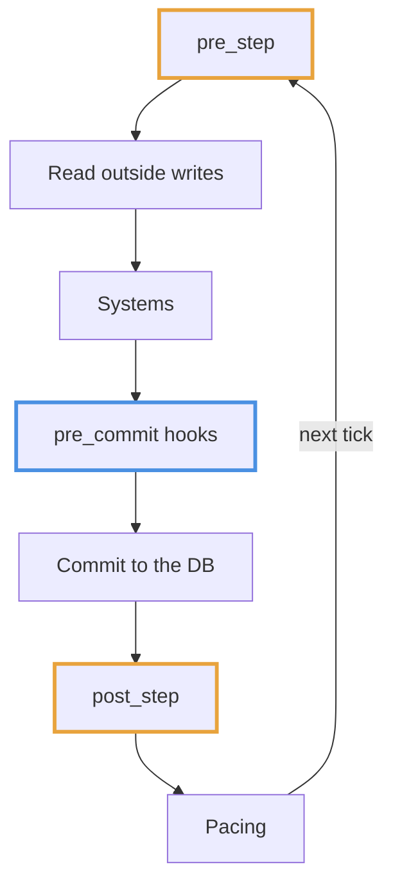
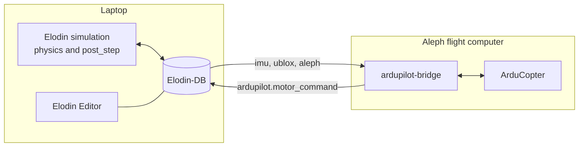

+++
title = "SITL & HITL"
description = "Put your flight software, and then your flight hardware, in the loop with an Elodin simulation, and choose between the post-step and pre-commit bridge styles"
draft = false
weight = 105
sort_by = "weight"

[extra]
toc = true
top = false
icon = ""
order = 5
lead = "Fly your real flight software against an Elodin simulation, then move it onto the flight computer, and pick the bridge style that fits your vehicles, rates, and tick budget."
+++

Software-in-the-loop (SITL) testing runs your real flight software build on a computer, against simulated sensors and actuators. Hardware-in-the-loop (HITL) testing runs it on the flight computer, with some or all of its inputs and outputs simulated. In both, the flight software reads sensors and commands actuators, and the simulation turns those commands into motion and new sensor readings.

Work up to it in three steps. Write the controller as an Elodin system to design and tune it, fly the real flight software in SITL, then fly it on the hardware in HITL. Each step finds bugs the one before cannot. SITL finds message framing errors, numerical edge cases, and timing assumptions in the real code. HITL finds what only the real processor, buses, and drivers do.

## The Elodin way

- **One world from model to flight.** The model, the SITL run, the HITL run, and the flight log share one database schema, so the same schematic, graphs, and analysis scripts work on all of them.
- **A narrow boundary.** The flight software sees only sensor values and commands only actuators. It never reads the simulation's truth state. Every component set from outside the systems is marked `external_control = "true"`, and the simulation never writes it.
- **Lockstep for repeatable runs, real time for people and hardware.** In lockstep the simulation waits for each reply, so a run gives the same answer every time.
- **The simulation launches the flight software.** [s10 recipes](/reference/s10) start the flight software processes with the simulation, hold the first tick until they are ready, and stop them at the end.
- **Every run is recorded.** Replay it in the editor, run it as a Monte Carlo campaign, or merge it with a flight log using [`elodin-db merge`](/reference/elodin-cli#elodin-db-merge).

## Inside one tick

Every tick runs the same phases in order. The two bridge styles attach at different points:



- `pre_step` and `post_step` (orange) are the **post-step style**. They get an [`el.StepContext`](/reference/python-api/#class-elodin-stepcontext) and work through the database.
- `pre_commit` hooks (blue) are the **pre-commit style**. They get an [`el.WorldStepContext`](/reference/python-api/#class-elodin-worldstepcontext) and work on the world's arrays before the commit.
- "Read outside writes" copies into the world what a bridge or a database client wrote to the database since the last tick, such as commands in `external_control` components.

In both styles, a command written at tick N is recorded at tick N and used by the systems at tick N+1. The [run receipt](/reference/python-api/#run-receipts) times each phase: `pre_step`, `copy_db_to_world`, `world_run`, `pre_commit`, `commit`, and `post_step`.

## Post-step style

In `post_step`, a bridge reads the tick's sensor values from the database by name, sends them to the flight software, waits for the reply, and writes the commands back. This is the [falcon9](https://github.com/elodin-sys/elodin/tree/main/examples/falcon9) bridge, abridged. It exchanges packets with the Rust flight software over UDP at 100 Hz, on every tenth tick of the 1 kHz simulation:

```python
READS = ["booster.imu_accel", "booster.imu_gyro", "booster.gps_pos", "booster.gps_vel"]

def post_step(tick: int, ctx: el.StepContext) -> None:
    if tick % guidance_period_ticks != 0:
        return
    reads = ctx.component_batch_operation(reads=READS)
    state = np.concatenate([reads[name] for name in READS])
    cmd = bridge.exchange(state)  # send the state, wait up to 1 s for the reply
    ctx.component_batch_operation(
        writes={"booster.engine_cmd": cmd[0:9], "booster.fin_cmd": cmd[23:26]}
    )

world.run(system, simulation_rate=1000.0, post_step=post_step)
```

`component_batch_operation` takes the database lock once for all its reads, or all its writes. When a reply does not arrive in time, falcon9 keeps the previous command. Choose this policy on purpose: holding the last command keeps a demo flying, but in CI a timeout usually means the run failed.

**Use it when:**

- you have one or a few vehicles;
- the bridge needs the database: any component or message by name, values from an earlier time (`read_component(name, timestamp=...)` and `read_msg(name, timestamp=...)`), or writes at chosen timestamps;
- the flight software runs slower than the physics, so the bridge exchanges only every few ticks;
- you are getting started. It is one function.

**Costs and cautions:**

- Every read and write goes through the database by name, so the cost grows with the number of components and vehicles.
- With a `pre_step` or `post_step`, the simulation thread writes each commit to the database itself, and that time counts against the tick.
- An exception in `pre_step` or `post_step` is logged as a warning, and the simulation keeps running. To make a bridge failure fail the run, record it in the run's result, or use pre-commit hooks.

[betaflight-sitl](https://github.com/elodin-sys/elodin/tree/main/examples/betaflight-sitl) uses this style at 8 kHz, exchanging with Betaflight's SITL firmware on every tick. [crazyflie-edu](https://github.com/elodin-sys/elodin/tree/main/examples/crazyflie-edu) and [aleph-ardupilot](#the-database-as-the-boundary) use it for HITL.

## Pre-commit style

A `pre_commit` hook runs after the systems and before the commit. Instead of looking components up by name on every tick, you choose the rows once, after spawning, with `world.prepare_component`, and group them with `world.prepare_batch`. On each tick, the hook gets those rows as NumPy arrays holding the tick's result, and writes its commands in place. The commands go into the same commit.

This is the [many-agents](https://github.com/elodin-sys/elodin/tree/main/examples/many-agents) exchange, abridged. One hook talks to 24 controller processes, one per agent, at 1 kHz. `agents` and `objects` are the spawned entities:

```python
exchange = world.prepare_batch({
    "position": world.prepare_component("position", agents),
    "velocity": world.prepare_component("velocity", agents),
    "object_position": world.prepare_component("object_position", objects),
    "command": world.prepare_component("command", agents, access="write"),
})

def exchange_step(tick: int, ctx: el.WorldStepContext) -> None:
    with ctx.batch(exchange) as view:
        view.command[...] = bridge.exchange(tick, view)  # every state out, every command back

world.run(system, simulation_rate=1000.0, generate_real_time=True,
          pre_commit=exchange_step, workers=8)
```

**Native hooks.** When a Python hook is too slow, move it into a shared library and load it with `el.NativeStepHook`. It runs without the GIL and can split the rows across threads:

```python
exchange_hook = el.NativeStepHook.load(
    "hook/build/release/libmany_agent_hook.so",
    input=exchange,
    symbol="many_agent_step",
    workers=2,
)
```

The library exports C functions. The [`NativeStepHook` reference](/reference/python-api/#class-elodin-nativestephook) gives the ABI, and many-agents implements one in Rust.

**Several hooks in order.** `pre_commit` also takes a list. Hooks run in list order, Python and native alike, and each one sees the world writes of the hooks before it. many-agents runs its exchange, then a hook that reads camera frames, then one that writes the result on the last tick:

```python
world.run(system, pre_commit=[exchange_hook, history_step, finish_step], ...)
```

**History and timestamped writes.** A hook can read committed database history through prepared handles, and queue writes at chosen timestamps that land after the commit. many-agents pairs each frame of its sensor camera with an agent's position at the moment the frame was captured:

```python
frames = world.prepare_message_history("camera.overhead")
truth = world.prepare_component_history("agent_000.position")
capture = world.prepare_timestamped_writer(
    {"frame": "camera.capture_frame", "truth": "camera.capture_truth"}
)

def history_step(tick: int, ctx: el.WorldStepContext) -> None:
    found = ctx.read_at(frames, capture_time, "exact")       # (timestamp, bytes) or None
    pose = ctx.read_at(truth, capture_time, "at_or_before")  # (timestamp, value) or None
    ctx.defer_write(capture, ctx.timestamp + 1, {"frame": frame_index, "truth": pose[1]})
```

`"exact"` never falls back to an older sample, so a frame the camera skipped comes back as `None` instead of a stale image.

**Failing fast.** If a hook raises, or a native hook returns nonzero, the later hooks are skipped, the tick is not committed, and the run stops. The receipt's `failed_hook` names the hook. A lost controller fails the run instead of logging a warning, which is what you want in CI.

**Use it when:**

- you have many vehicles, or many components per vehicle;
- the exchange must fit a tight tick budget;
- you want the bridge in native code, off the GIL;
- a broken link should stop the run.

**Costs and cautions:**

- Prepare handles after spawning the entities and before `world.run`.
- A hook can only write components marked `external_control = "true"`. Preparing a write handle on any other component raises an error.
- A native hook runs inside the simulation's process, so a crash in it takes the simulation down.
- Without step callbacks, a writer thread appends each commit to the database while the next tick runs. History handles, timestamped writers, and `synchronous_commits=True` make commits synchronous instead, so history reads see every earlier commit.

## Choosing a style

| | Post-step | Pre-commit |
|---|---|---|
| Callback | `pre_step` or `post_step`, with `el.StepContext` | `pre_commit` hooks, with `el.WorldStepContext`, or `el.NativeStepHook` |
| Data access | Any component or message, by name, through the database | Rows prepared once, as arrays; database history through prepared handles |
| Commands recorded | By the bridge's own write, after the tick's commit | In the tick's commit |
| Commits | Written on the simulation thread | On a writer thread, unless the run needs them synchronous |
| A callback that fails | Logs a warning; the run continues | Stops the run; the receipt names the hook |
| Native code | No | Yes, without the GIL, across threads |
| Good fit | One or a few vehicles, exchanges slower than the physics, HITL through the database, a first SITL | Many vehicles, tight tick budgets, CI runs that must fail fast |

**How much work each takes.** A post-step bridge is the least work: one function, a socket, and the component names you already have. A Python pre-commit hook needs a little planning, because you decide up front which rows the bridge touches, and history reads and timestamped writes need their own handles. A native hook is the most work: a shared library with a C ABI, built before the simulation starts.

### Measured

These numbers come from run receipts on one host (Linux, 16 cores and 22 threads, 32 GB RAM), leaving out the first 2,000 ticks as warm-up. "Callback" is the time spent in `post_step` or in the hooks, including the wait for the flight software's reply.

| Example | Style and loop | Callback, mean / p95 | Commit, mean | Result |
|---|---|---|---|---|
| falcon9 | Post-step; one exchange every 10 ticks at 1 kHz; as fast as possible | 32 / 204 µs | 6.8 µs | 520 s of flight in 44 s, 11.8× real time |
| betaflight-sitl | Post-step; one exchange every tick at 8 kHz; real time | 102 / 152 µs | 2.7 µs | 0.96× real time |
| many-agents (`lockstep`) | Pre-commit, native hook; 24 controllers at 1 kHz; real time | 329 / 441 µs | 24 µs | 998 ticks per second |

falcon9's mean is low because nine ticks in ten skip the exchange, and its p95 is roughly the cost of one exchange. betaflight-sitl shows the limit of exchanging on every tick: the bridge takes 102 µs of each 125 µs tick, a whole tick averages 130 µs, and the run falls slightly behind real time. In its `lockstep-history` mode, with history reads and deferred writes, many-agents commits synchronously: commits average 38 µs instead of 24 µs, and the run still holds 990 ticks per second.

To compare the styles on identical work, we also wrote the many-agents exchange as a post-step bridge, with the same 24 controllers, rate, and pacing:

| Bridge | Callback, mean / p95 | Commit, mean | Late ticks, of 10,000 | Ticks per second |
|---|---|---|---|---|
| Post-step, `component_batch_operation` | 740 / 971 µs | 106 µs | 4,359 | 894 |
| Pre-commit, Python hook | 344 / 612 µs | 17 µs | 104 | 997 |
| Pre-commit, native hook | 325 / 419 µs | 23 µs | 65 | 999 |

Most of the native hook's 325 µs is spent waiting for the 24 controllers to reply. The post-step bridge needs about 400 µs more per tick to read and write the agents' components through the database, and it writes its commits on the simulation thread, so it cannot keep up with a 1 ms tick. Both hooks keep up. The native hook mostly shortens the slow tail.

### Moving a bridge from post-step to pre-commit

1. Check that every component the bridge writes is marked `external_control = "true"`. A post-step bridge usually has this already.
2. After spawning, prepare the components the bridge reads and writes, and group them in a batch.
3. Move the exchange from `post_step` into a `pre_commit` hook that uses `ctx.batch(...)` views instead of names.
4. Replace reads at a timestamp with history handles and `ctx.read_at`, and writes at chosen timestamps with a timestamped writer and `ctx.defer_write`.
5. Raise on a lost link instead of logging it, and check the receipt's `failed_hook` when a run stops.
6. If the hook is still too slow, port it to a native hook.

### Using both

`world.run` accepts `post_step` and `pre_commit` together, so a `post_step` can do occasional database work next to a pre-commit exchange. With a `post_step` present, the simulation thread writes the commits again, so drop it if you don't need it.

## SITL in practice

**Launch the flight software with the simulation.** Register it as an s10 recipe. Build it from source in the editor and use a prebuilt binary in campaigns, give each campaign worker its own ports, and hold the first tick until the flight software is ready. [Process Orchestration (s10)](/reference/s10#sitl-patterns) covers each of these.

**Agree on a packet format.** Fixed-size, little-endian packets that carry a version and the tick number make a stale or out-of-order reply easy to spot. Decide what a timeout means before you need to: hold the last command, or fail the run.

**Choose lockstep or free-running, and real time or as fast as possible.**

| | As fast as possible | Real time (`generate_real_time=True`) |
|---|---|---|
| **Lockstep:** the simulation waits for each reply | Repeatable and fast: campaigns and CI (falcon9) | Repeatable and watchable, with people or tools attached (betaflight-sitl, many-agents) |
| **Free-running:** each side keeps its own clock | Rarely useful: the flight software sees time jump | Flight software or hardware that keeps its own clock (aleph-ardupilot) |

**Feed sensors, not truth.** Model sensors in systems, with their noise, bias, rate, and delay, and send the flight software those values. For cameras, a [sensor camera](https://github.com/elodin-sys/elodin/tree/main/examples/sensor-camera) renders frames into the database as messages. Read a frame by the time it was captured: `ctx.read_at(frames, t, "exact")` in a hook, or `ctx.read_msg(name, timestamp=t)` in `post_step`. To model the camera's delay, read the frame from `latency` microseconds before the current tick.

**Scale out.** The same SITL runs headless under [`elodin monte-carlo`](/reference/elodin-cli#elodin-monte-carlo), with one simulation and flight software stack per worker.

### Proving a run repeats

A lockstep run with fixed seeds and `start_timestamp` should repeat bit for bit. When two runs end in different states, a [deterministic witness](/reference/python-api#deterministic-witnesses) shows where they first parted: in the world after the systems, in what a hook sent or got back, in what it wrote, or in what the commit recorded.

1. Prepare a witness over the batches your hooks use. Give each hook a channel for what it sends, another for the part of each reply the flight software decided, and an external channel for the whole reply.
2. Record a baseline with `raw=True`, and pass it as `reference` to the runs you check. The receipt names the first mismatch, and the witness keeps the exact bytes around it.
3. Compare any two witnesses with [`elodin determinism compare`](/reference/elodin-cli#elodin-determinism).
4. Replay a hook from a witness, without the simulation or the flight software, with `world.replay_pre_commit` or `elodin determinism replay-hook`. If the replay reproduces every byte, the difference came from outside the hook.

Keep host-only fields, such as a reply's service time, out of the compared channels: the external channel keeps the whole reply for replay, and is never compared. [many-agents](https://github.com/elodin-sys/elodin/tree/main/examples/many-agents) walks through a one-bit fault, a controller race, and its fix.

## HITL in practice

In HITL the flight software runs on the flight computer and keeps its own clock. Run the simulation in real time, put timestamps on what crosses the link, and expect some jitter between the two clocks. Keep the same boundary as in SITL, so the flight software cannot tell the difference. Three layouts work well.

### The database as the boundary

[aleph-ardupilot](https://github.com/elodin-sys/aleph-ardupilot) runs ArduCopter on the [Aleph](/home/aleph/setup) flight computer. A Rust bridge on the Aleph subscribes to sensor entities in Elodin-DB, converts them into ArduPilot's sensor packets, and writes ArduPilot's motor commands back to the database and to the CAN motor controllers. In normal operation, the Aleph's own sensors feed a database on the Aleph. In sim-HITL mode, the bridge connects to the database of a simulation running on a laptop instead:



The simulation runs at 760 Hz in real time. Its `post_step` writes simulated sensors into the same `imu`, `ublox`, and `aleph` entities the real sensors use, in the same formats, down to GPS fixes as UBX integers with seeded noise. It also copies the motor commands the bridge wrote, `external_control` components, into the physics. The bridge cannot tell the simulation from the real sensors, so the same flight software and bridge fly in both modes:

```sh
./deploy.sh -c sim-hitl -h <aleph-ip> -u root   # point the Aleph's bridge at the laptop
elodin run sim/sim-hitl/main.py                 # on the laptop
```


aleph-ardupilot was built against an earlier Elodin release. Its pattern is current, but expect to update the Elodin version its flake pins.


The same layout works for SITL. Any program that talks to Elodin-DB over [Impeller or gRPC](/reference/grpc-client) can read sensor components and write `external_control` commands, with no bridge inside the simulation.

### A link bridge on the host

When the flight computer talks over a radio, a serial line, or UDP, run a bridge on the host as an s10 recipe, and hold the first tick until the link is up. The simulation exchanges with the bridge the way it would with SITL flight software. [s10's HITL patterns](/reference/s10#hitl-patterns) cover readiness checks, timeouts, and restart policies.

### Hardware as the source of truth

crazyflie-edu's `--hitl` mode turns the physics off. The student's code runs on the Crazyflie, keyboard commands reach it over the Crazyradio, and its real IMU data streams into the editor. The controls and graphs are the same as in SITL, where the same C code runs against the simulation:

```sh
elodin editor examples/crazyflie-edu/main.py --hitl
```

### Safety

- Take the propellers off for bench HITL, or tie the vehicle down.
- Keep a hardware kill switch, and require a deliberate action to arm. crazyflie-edu runs its motors only while a dead man switch is held.
- Give the flight software a failsafe for a lost link, and test it by stopping the simulation in flight.
- Check that stopping the simulation stops every companion process. `elodin run` stops all recipes when the simulation exits.

## Good habits

- **Draw the boundary first.** List what the flight software reads and writes before writing the bridge, and mark every write `external_control`.
- **Use one schema for simulation and hardware.** Then the same flight software, schematic, and scripts work on both.
- **Seed every random number and fix `start_timestamp`,** so a lockstep run repeats exactly. Record a witness to prove it.
- **Watch the tick budget.** Set `ELODIN_SIM_SUMMARY_JSON` to write the receipt, and compare `callback`, `commit`, and `total_cycle` with the tick period.
- **Compare runs with flight data.** Merge a SITL run with a flight log and plot them together.

## Troubleshooting

| Symptom | What to check |
|---|---|
| The simulation keeps running after the flight software crashed | Outside campaigns, a recipe that exits does not stop the simulation. Detect the lost link in the bridge, or raise in a `pre_commit` hook to stop the run. |
| Commands act one tick late | This is expected: a command written at tick N is used at tick N+1, in both styles. |
| The run falls behind real time | Compare `callback`, `commit`, and `world_run` in the receipt with the tick period. Exchange less often, move to pre-commit hooks, or use a native hook. |
| `Ready.tcp` is rejected | It needs an IP address, such as `127.0.0.1:9000`, not `localhost:9000`. |
| A write fails with `TimeTravel` | Its timestamp is older than the component's last sample. A failed deferred write stops the run, and `failed_hook` names the hook. |
| Preparing a write handle fails | The component must be marked `external_control = "true"`. |
| The flight software sees the wrong attitude or motion | Check frames (ENU or NED, FLU or FRD), units, and quaternion order on both sides of the link. |
| A camera frame is missing | The render server skipped it to catch up. `read_at(..., "exact")` returns `None` for it instead of an older frame. |
| Two lockstep runs end in different states | Record both with a witness, the second with the first as `reference`, and read `witness.first_mismatch` in the receipt. A differing response after an equal ingress points at the flight software; a mismatch in `after_systems` points at the simulation. |

## Examples

| Example | Style | Loop | Shows |
|---|---|---|---|
| [falcon9](https://github.com/elodin-sys/elodin/tree/main/examples/falcon9) | Post-step | SITL, lockstep, as fast as possible | Rust flight software over UDP at 100 Hz in a 1 kHz simulation, and Monte Carlo campaigns |
| [betaflight-sitl](https://github.com/elodin-sys/elodin/tree/main/examples/betaflight-sitl) | Post-step | SITL, lockstep, real time | Betaflight's SITL firmware, exchanging on every tick at 8 kHz |
| [crazyflie-edu](https://github.com/elodin-sys/elodin/tree/main/examples/crazyflie-edu) | Post-step | SITL and HITL | The same C code in SITL and on a Crazyflie, and HITL with the physics off |
| [aleph-ardupilot](https://github.com/elodin-sys/aleph-ardupilot) | Post-step | HITL, free-running, real time | ArduCopter on Aleph, with the simulation and the hardware writing the same database entities |
| [many-agents](https://github.com/elodin-sys/elodin/tree/main/examples/many-agents) | Pre-commit | SITL, lockstep, real time | 24 controllers at 1 kHz: prepared batches, a native hook, history reads, deferred writes, and receipts |
| [apollo-lander](https://github.com/elodin-sys/elodin/tree/main/examples/apollo-lander) | Post-step | SITL, lockstep, campaigns | A complete Monte Carlo campaign around real flight software ([tutorial](/home/apollo-lander)) |

## Related docs


Launch, order, and stop flight software and link bridges with the simulation.



The `pre_step` and `post_step` API: reads, writes, history, and messages.



Prepared handles, `WorldStepContext`, native hooks, and run receipts.



A SITL Monte Carlo campaign built step by step.

