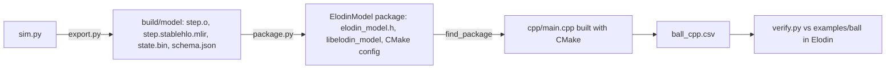

# Ball in C++

The [ball](../ball) simulation, written in Elodin's Python/JAX API, run from a standalone C++
program. Elodin compiles the simulation's step to native code and packages it as a shared
library with a C header and a CMake package. The C++ program links that library, owns the
loop, and runs without Python, JAX or Elodin installed. `verify.py` then checks that every tick
matches the original ball example run in Elodin.

The [Custom C++ Runtimes](https://docs.elodin.systems/reference/cpp-runtime/) reference covers
the workflow in general, with [many-agents-cpp](../many-agents-cpp) as the full SITL.



## Run it

From the repository root, inside `nix develop` after `just install`:

```sh
bash examples/ball-cpp/run.sh
```

That runs every step below, for both backends and for a `generic` CPU, and ends with the
parity check. Generated files go to `examples/ball-cpp/build/`.

### 1. Test the simulation in Elodin

```sh
elodin editor examples/ball-cpp/main.py
```

`sim.py` and `schematic.py` are the ball example's: gravity, drag against a random wind, and
a bounce, integrated by `six_dof`.

### 2. Export the step

```sh
python3 examples/ball-cpp/export.py
```

`export.py` builds the simulation with `World.to_jax` and calls `JaxSim.export_model`, which
writes `build/model/`:

| File | Contents |
| --- | --- |
| `step.stablehlo.mlir` | One whole tick, from every component's value to its next value |
| `step.o` | The same tick compiled ahead of time by Elodin's Cranelift backend, for this machine |
| `state.bin` | The initial value of every component, as raw little-endian bytes |
| `schema.json` | The model's layout: its time step, and each component's type, shape and entities |
| `model-manifest.json` | The target `step.o` was compiled for, and each file's SHA-256 and size |

The step is `JaxSim.step_fn`, not just the systems: it carries forward components no system
writes and puts each output back in its component's slot, so the native side only swaps buffers.

### 3. Package it as a library

```sh
python3 libs/elodin-model/package.py examples/ball-cpp/build/model examples/ball-cpp/build/ElodinModel
```

This builds `libs/elodin-model` around the model and lays out a CMake package:

```text
ElodinModel/
  ElodinModelConfig.cmake
  include/elodin_model.h, elodin_model.hpp, elodin_step_hook.h
  lib/libelodin_model.so, libelodin_model.a
  schema/state/step artifacts, build manifests, runtime SBOM
```

The CMake targets are `ElodinModel::shared` and `ElodinModel::static`.

`--backend` picks how the model's code gets into the library:

- `aot` (default) links `step.o`. The library contains the model's machine code and the small
  runtime its calls need, and never compiles anything.
- `jit` embeds the StableHLO and Elodin's Cranelift compiler, and compiles the step once when
  the program is opened.

Both run the same Cranelift code, so they produce identical results.

`--cpu generic` compiles `step.o` again from the StableHLO, on the machine that packages, for
any CPU of its architecture instead of the exporting CPU's own features. That is the library to
build on a delivery machine, which needs Rust and Python 3.11 but not Elodin's Python SDK.
`run.sh` builds it too and holds it to the same check against Elodin.

### 4. Build the C++ host

```sh
cmake -S examples/ball-cpp/cpp -B examples/ball-cpp/build/cpp \
  -DElodinModel_DIR="$PWD/examples/ball-cpp/build/ElodinModel"
cmake --build examples/ball-cpp/build/cpp
```

[`cpp/CMakeLists.txt`](cpp/CMakeLists.txt) needs only two lines to use the model:

```cmake
find_package(ElodinModel CONFIG REQUIRED)
target_link_libraries(ball_cpp PRIVATE ElodinModel::shared)
```

`cmake --install` copies `bin/ball_cpp` and `lib/libelodin_model.*` with a relative runpath,
so the installed directory can move.

### 5. Run it

```sh
examples/ball-cpp/build/cpp/ball_cpp examples/ball-cpp/build/ball_cpp.csv 1200 0
```

The arguments are the output CSV, the number of ticks and the wind seed. The program prints
the model's components, steps the ball, and writes `world_pos` and `world_vel` at every tick.

### 6. Verify against Elodin

```sh
python3 examples/ball-cpp/verify.py examples/ball-cpp/build/ball_cpp.csv
```

`verify.py` runs the original [`examples/ball`](../ball) with `World.build` for as many ticks,
compares every value, and saves a plot next to the CSV. It fails on any difference larger than
`--atol`, which is 0: the native results should be bit for bit equal to Elodin's.

## The C interface

[`elodin_model.h`](../../libs/elodin-model/include/elodin_model.h) separates a program, the
model's code and initial state, from instances, one run each:

```c
ElodinModelProgram *program = elodin_model_open();
ElodinModelInstance *ball = elodin_model_create(program);

size_t pos = (size_t)elodin_model_component_index(program, "world_pos");
double world_pos[7];
elodin_model_step(ball);
elodin_model_read(ball, pos, world_pos, sizeof world_pos);

elodin_model_destroy(ball);
elodin_model_close(program);
```

`elodin_model_write` sets a component between steps, `elodin_model_reset` returns an instance
to the initial state, and failures return `NULL` or nonzero with the reason in
`elodin_model_error()`. Instances of one program are independent of each other.

## How the ahead-of-time library works

`step.o` is the same code Elodin's Cranelift backend runs in a simulation, emitted as a
position-independent object instead of into memory. Its calls into the Cranelift runtime
(math functions, tensor kernels) go through a table of function pointers in the object, which
`libelodin_model` fills in by name when the program is opened. The object needs nothing else
from the linker except the C library.

## Limits

- `step.o` is compiled for one OS and CPU architecture, and as exported for this CPU's
  instruction-set extensions. Package with `--cpu generic` on a machine with the target's OS
  and architecture for a library that runs on any CPU there.
- The library and its C symbols have fixed names, so a process holds one model.
- A step runs on the caller's stack. The ball needs nothing special; large models can need
  more stack than a default thread has, as Elodin's own simulation thread does.
