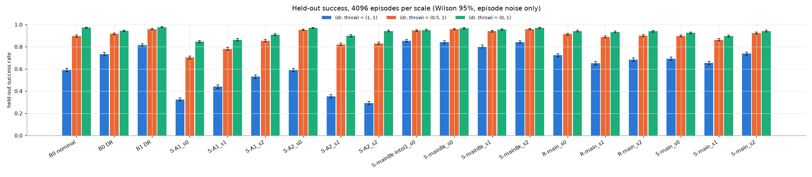
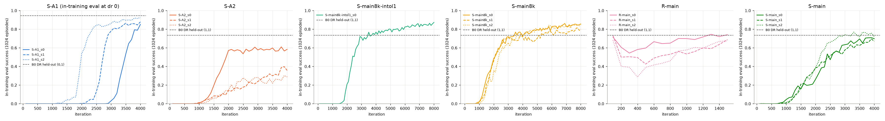
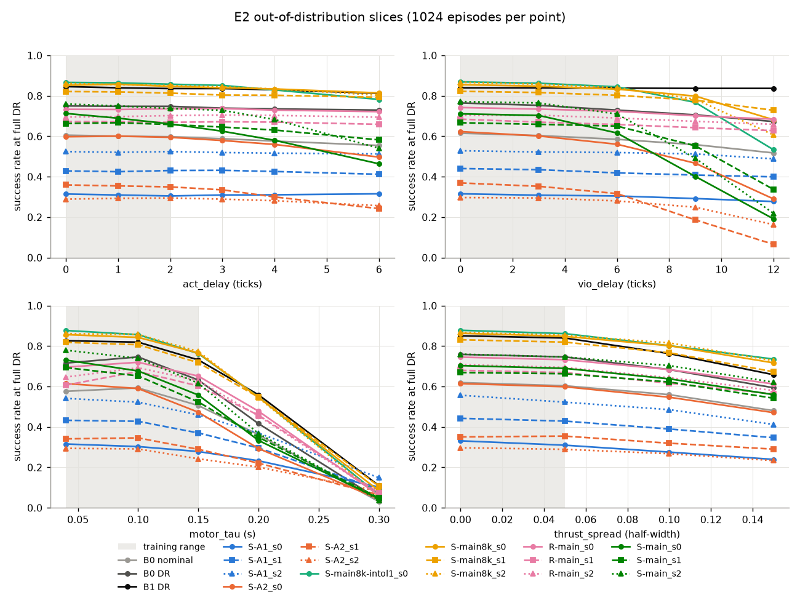
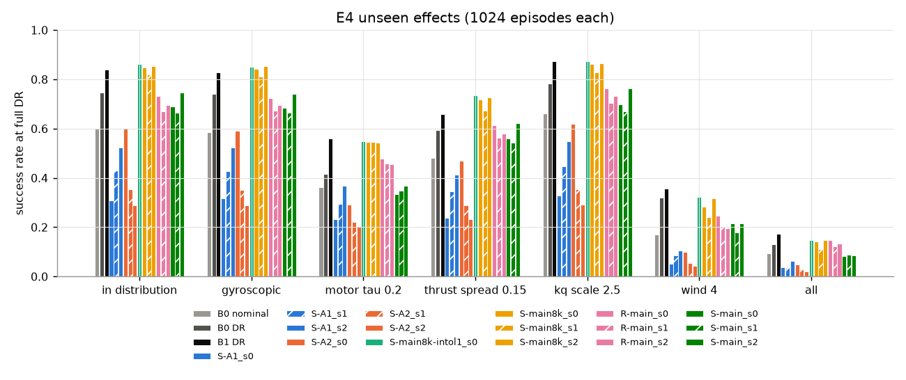

# Drone policy

A PPO policy that catches a thrown quadcopter and holds it at a hover target, trained and deployed
in Elodin. Each episode throws the stock Talon quad from [examples/drone](../drone) at a random
attitude, rate, velocity and offset; the controller has 5 s to reach the target and must stay inside
the success tolerances for the final 1 s ([env.py](env.py), [dr.py](dr.py)). Plant, sensor and
latency parameters are randomized per episode (DR). The policy sees only what the vehicle could
measure: an in-graph MEKF attitude estimate, the gyro, and a VIO-style position and velocity stream.
The baseline is a cascade whose gains were tuned by random search under the same randomization.
Everything here is simulation; nothing has flown.

## Results

4096 held-out episodes per scale, deterministic, with the same reset keys for every row, so
controller differences are paired per episode. (1, 1) is full DR and throws; (0, 1) is the nominal
plant with full throws. Full tables: [results/summary.md](results/summary.md) and
[results/results.json](results/results.json).

| controller | success at (1, 1) | crashed | vs B0-DR, paired | (0.5, 1) | (0, 1) |
| --- | --- | --- | --- | --- | --- |
| PPO, 3 seeds (S-main8k) | 0.829 [0.771, 0.886] | 0.030 | +0.095 [+0.037, +0.152] | 0.952 | 0.964 |
| PPO, shipped seed (S-main8k_s2) | 0.843 [0.831, 0.854] | 0.034 | +0.109 ± 0.007 | 0.958 | 0.970 |
| B1-DR: B0-DR fed true state | 0.816 [0.804, 0.828] | 0.076 | +0.083 ± 0.005 | 0.959 | 0.977 |
| B0-DR: cascade tuned under DR | 0.734 [0.720, 0.747] | 0.102 | reference | 0.917 | 0.944 |
| B0 nominal: tuned on the nominal plant | 0.591 [0.576, 0.606] | 0.073 | -0.143 ± 0.007 | 0.896 | 0.972 |

The 3-seed row gives t 95% intervals over seeds (seed SD 0.023). Single runs give Wilson 95%
intervals, which count episode noise only, and ± is the standard error of the paired difference.
Crashed means terminated at (1, 1): the drone fell too low or flew too far.

- Each seed beats B0-DR at (1, 1) by 0.068 to 0.109 on the same episodes. The learned policy crashes
  in 3.0% of episodes against 10.2%, under a third as often. Its other misses survive without
  holding the final window: 0.12 to 0.17 of episodes, against 0.165 for B0-DR.
- At (0.5, 1) the lead over B0-DR is 0.036 [0.010, 0.061]. On the nominal plant it is 0.020
  [0.003, 0.037], only 0.014 [-0.006, +0.033] on fresh episodes, and B0 nominal, the cascade tuned
  for that plant, is ahead of every seed (0.972 against 0.964).
- B1-DR runs the B0-DR gains, not retuned, on true attitude, rates, position and velocity: a
  privileged reference, not an upper bound. At (1, 1) the policy is within noise of it (+0.012
  [-0.045, +0.070]; two seeds above, one below), and 0.007 to 0.013 below it at the lower scales
  (0.013 to 0.018 on fresh episodes).
- The 4000-iteration recipe's learning rate and iteration count, the residual variant and the
  shipped seed were chosen on these seed-20011 episodes (B0-DR's gains on separate ones). On 4096
  fresh episodes (seed 31337) that played no part in any choice, the policy scores 0.825 against
  0.735, a gap of 0.090 [0.024, 0.156], and the selected runs' gaps moved by -0.006 to +0.002,
  within episode noise ([results/replicate_seed31337](results/replicate_seed31337/summary.md)).
  The shipped seed, best of three here, is a near-tie with seed 0 (+0.0015 ± 0.0051) and scores
  0.841 on the fresh episodes.



## Observations and actions

The actor reads 19 floats computed in the graph at the end of each 300 Hz tick
([policy_io.py](policy_io.py)): the body-frame up vector from the attitude estimate (roll and pitch
only), the gyro (rad/s, body FLU, biased, 40 Hz biquad), VIO position error and velocity in the
heading frame, a clipped integral of the position error, and the previous action. Truth and the DR
parameters go only to the critic (61 floats). The estimate comes from mekf6
([mekf6.py](mekf6.py)), a 6-state MEKF on the sim gyro, accelerometer and magnetometer, so training
has the estimator in the loop. The action is 4 numbers in [-1, 1] at 100 Hz, held for 3 ticks:
body-rate setpoints (times 3, 3 and 1.5 rad/s) and a collective of 0.689509 + 0.311 a[3], clipped to
[0.1, 1.0]. A rate PID and the examples/drone mixer close the loop at 300 Hz, with rate gains
scaled per axis by U(0.8, 1.25).

## What the ablations show

S-A1 and S-A2 each change one setting of S-main, the same recipe at 4000 iterations (0.695 at
(1, 1), seed SD 0.043). S-A1 and two S-A2 seeds were still improving at 4000, so these compare at
that budget, and per-seed paired differences are given because three seeds make wide intervals.

- **DR.** Trained on the nominal plant (S-A1, throws still random), the policy reaches 0.432 at
  (1, 1), 0.263 below S-main [0.039, 0.486], or 0.366, 0.214 and 0.208 per seed. Every seed is
  also worse on the nominal plant it trained on, by 0.032 to 0.078.
- **Estimator in the loop.** S-A2 trains on true attitude. Flown on mekf6, which is what the
  vehicle has, it reaches 0.317 (seeds 0.476, 0.285, 0.189), 0.217 to 0.550 below S-main per seed.
  Swapping its observations from truth to mekf6 alone costs 0.096 [0.037, 0.155] at (1, 1) and about
  0.3 at the lower scales; S-A2 also trails S-main on truth (0.413), so not all of its gap is the
  estimator. Conversely, S-main8k flown on true attitude gains 0.028 [0.017, 0.038] at (1, 1) and
  about 0.01 lower down, where the intervals include 0: what estimator error costs it in sim.
- **Budget.** 8000 iterations, with the learning-rate decay stretched to match, took S-main from
  0.695 to 0.829: +0.134 [0.069, 0.198] paired, 0.104 to 0.149 per seed, +0.126 on fresh episodes.
  Iterations and schedule changed together, and the curves below still creep up at 8000.
- **Residual.** A residual over B0-DR trained for 1500 iterations (R-main) did not improve on it:
  0.687, or -0.047 [-0.136, +0.042]. A 3000-iteration single-seed variant scored lower (0.677).
  R-main had 49M env steps against S-main8k's 262M, and different hyperparameters, so it says
  nothing about residual against from-scratch training.
- **Not in the table.** A single seed with a 4x in-tolerance reward weight scored 0.854 at (1, 1)
  but crashed nearly twice as often (5.2% against 2.9%) and lost at the lower scales. An earlier
  recipe (reward v2, default critic initialization, 1500 iterations) reached 0.006 on a
  2048-episode check; too much changed after it to blame the reward.



## Robustness

E2 and E4 run at full DR on the first 1024 held-out episodes (B0-DR scores 0.746 there), and the
S-main8k numbers are seed means.

- **E2, one parameter past its training range.** At 6 ticks (20 ms) of extra action delay, against
  0 to 2 in training, S-main8k drops from 0.845 to 0.803 and B0-DR from 0.750 to 0.729. VIO delay
  is its weakest axis: 0.848 falls to 0.672 at 12 ticks (40 ms; training 0 to 6), level with B0-DR
  (0.673), while B1-DR on true position holds 0.837. At a motor time constant of 0.3 s (training
  0.04 to 0.15 s) every controller fails: 0.082 for S-main8k, 0.041 for B0-DR.
- **E4, effects absent from training.** The gyroscopic torque that `six_dof` leaves out costs almost
  nothing (0.840 to 0.836). A 4 m/s wind costs most and is the one case where S-main8k falls below
  B0-DR: 0.281 against 0.319 (B1-DR 0.357). Everything at once: S-main8k 0.133, B0-DR 0.131,
  B1-DR 0.174.





## Deploy inside Elodin

[policy_system.py](policy_system.py) runs a policy as an `el.System` at the head of the 300 Hz
chain, acting on the first of every 3 ticks like the training env. [main.py](main.py) flies N
thrown drones with the shipped policy in [policy/](policy) (S-main8k seed 2). Sim-to-sim parity
against the JAX training env (results.json `e6`):

- 1 drone on Cranelift: max position difference 1.6e-5 m over 300 ticks. Over 256 held-out
  episodes of 1500 ticks, success and crash labels agree on 256 of 256 (223 successes each side),
  and the max position difference has median 1.0e-6 m, p90 3.2e-4 m and max 2.2e-3 m.
- 16 drones in one jax-cpu world against 16 vectorized env episodes: 16 of 16 labels agree, median
  6.9e-6 m.
- `DRONE_N=16 main.py bench --ticks 1500` on jax-cpu: 5.3 ms per 3-tick step, 1.9x real time.

`evaluate.NumpyPolicy` runs the exported policy with numpy alone. It matches the JAX float64
forward to 1.2e-15 (6.3e-15 at worst over 16 policies) in a median 6.07 µs per call (p99 9.6 µs),
timed on the x86 workstation without elodin-db I/O. Training throughput (`e10`): 495,655 env
steps/s in a 1024-env rollout, 82.6 simulated flight hours per wall minute; S-main8k's PPO loop
ran at 120k to 130k steps/s with two runs sharing the machine.

## Reproduce

One 32-core x86 machine, 8 XLA host devices per job, run from the repository root. The numbers
above used an editable elodin at 806b077 with fixes 1 to 3 below; on the released 0.20.0, without
them, the Cranelift parity tests fail.

```sh
# the shipped policy (S-main8k seed 2): 2381 s, sharing the machine with a second run
python examples/drone-policy/train.py --estimator mekf6 --dr curriculum --throw curriculum \
    --curriculum-iters 300 --iters 8000 --num-envs 1024 --steps 32 --devices 8 \
    --eval-every 100 --eval-envs 1024 --final-eval 1,1 0.5,1 0,1 --final-eval-envs 4096 \
    --final-eval-seed 20011 --lr 1.5e-4 --lr-end 3e-5 --ent-coef 1e-3 \
    --init-std 0.1,0.1,0.1,0.2 --in-tol-weight 0.25 --critic-head-gain 0.01 \
    --actor-warmup 20 --seed 2 --out runs/policy_s2

# every run in the tables, two at a time ($PYTHON picks the interpreter)
GRID=t3 examples/drone-policy/train_grid.sh   # S-main, R-main: 37 min, ~/drone-policy-runs/t3
GRID=t4 examples/drone-policy/train_grid.sh   # S-main8k*, S-A1, S-A2: 2 h 10 min

# all sections and figures: 1226 s (e1 also writes heldout_episodes.npz, about 1 MB, git-ignored)
python examples/drone-policy/evaluate.py all --runs ~/drone-policy-runs/t4 ~/drone-policy-runs/t3 \
    --out examples/drone-policy/results
# the fresh-episode replicate: 249 s
python examples/drone-policy/evaluate.py e1 --seed 31337 \
    --runs ~/drone-policy-runs/t4 ~/drone-policy-runs/t3 \
    --out examples/drone-policy/results/replicate_seed31337

pytest examples/drone-policy/tests   # --runslow adds the eval harness and long parity runs

# fly the shipped policy; main.py's docstring lists the DRONE_* settings
DRONE_N=16 python examples/drone-policy/main.py bench --ticks 1500
DRONE_N=4 elodin editor examples/drone-policy/main.py
```

## What it took in the SDK

1. nox-py: `Exec.run` stamps ticks in sim time, so stepping a world in chunks, as a training or
   HITL loop does, no longer fails with "db time travel".
2. nox-py: `JaxSim.set_state` persists, and one-entity components index right.
3. cranelift-mlir: SSA value ids stay unique across nested regions; before, the drone mixer's
   first saturation sent all four motors to minimum on Cranelift.
4. examples/drone: `--telemetry` runs at the configured rate.
5. fsw/mekf: `aleph.gyro_est` stops subtracting the bias twice, and a zero magnetometer vector no
   longer turns the filter NaN.

[#922](https://github.com/elodin-sys/elodin/issues/922) collects the Cranelift miscompiles found
by differential testing against jax-cpu (scatter with slices, bool compares and integer clamp on
the pointer ABI, `jnp.prod`, `argmax`, `erfc`).
The code here works around what is still broken: mekf6, the B0 cascade and the VIO buffer avoid
scatter and integer ops, [policy_system.py](policy_system.py) broadcasts its hold predicate (a
rank-0 select predicate in a pointer-ABI function is miscompiled, which broke every
truth-estimator world), and multi-drone worlds default to jax-cpu. The vehicle configs moved from
`examples/drone/main.py` to [vehicles.py](../drone/vehicles.py) so this example can import them.

## Limitations

- One simulated vehicle, the stock Talon: 2.586 kg, full-throttle thrust-to-weight about 1.33. DR
  was narrowed so the worst draw keeps about 1.15: mass x U(0.9, 1.1), per-motor thrust
  x U(0.95, 1.05), motor time constant 0.04 to 0.15 s, the rest in [dr.py](dr.py). The hover
  collective, trim and observation scaling are fitted to this vehicle.
- The VIO stand-in ([vio.py](vio.py)) is truth plus a per-episode bias up to 2 cm per axis and
  white noise (sigma up to 2 cm and 5 cm/s), at 30 Hz, delayed 0 to 20 ms; yaw is truth plus 0.5 deg
  of noise. No drift, scale error, dropouts or frame misalignment.
- Latency is a 100 Hz hold plus 0 to 2 ticks (0 to 6.7 ms) of action delay: no jitter, no dropped
  messages, and inference takes no sim time.
- mekf6 is the roci-adcs filter math with its own sim tuning, on clean sim sensors (median tilt
  error 0.92 deg); the sim magnetometer sees a horizontal unit field with no inclination.
- Three seeds per config, ablations at a 4000-iteration budget they had not converged in, and one
  residual recipe, which did not beat B0-DR (0.687 against 0.734).
- Cranelift: multi-drone worlds hit a known multi-entity miscompile and run on jax-cpu.
  Truth-estimator worlds diverged by 1.34 to 1.65 m in 300 ticks before the predicate broadcast and
  now match to 7.5e-6 m, but the backend bug is unfixed.

## What is missing for Aleph

Nothing here has run on hardware. Before it can:

- **Actuator path.** The policy outputs rate setpoints and a collective for a rate loop and mixer
  Aleph does not have. The only Orin-to-MCU message is `Command { gpios: [bool; 8] }`, and
  sensor-fw writes one CRSF throttle to all four DShot outputs
  ([command.rs](../../fsw/sensor-fw/src/command.rs), [main.rs](../../fsw/sensor-fw/src/main.rs)).
  Betaflight 4.5, which the Aleph docs describe flashing, would close the inner loop with a
  different rate controller and stop the elodin IMU and MEKF pipeline.
- **IMU frames.** `imu.gyro` is raw deg/s at about 770 Hz, labelled FRD, with per-chip sign flips
  ([x, y, -z] on I2C, [-x, y, z] on SPI, both determinant -1). The policy wants rad/s in body FLU
  behind a 40 Hz biquad. The physical frame needs a tilt-and-rotate test on the vehicle.
- **fsw/mekf configuration.** With the service's shipped sigmas and no accel gate, mekf6 breaks the
  shipped policy in sim: 0 of 4096 held-out episodes succeed and all terminate, and the accel sigma
  alone is enough to do it. The service also runs at about 770 Hz with a fixed dt of 1/800 s,
  `aleph.q_hat`'s frame convention is unverified, and `aleph.gyro_est` double-subtracts the bias
  until fix 5 lands.
- **VIO and ROS bridge.** Nothing supplies position, velocity or yaw: elodin-db has no VIO
  component and the elodin repo has no ROS 2 or ZED code. An adapter must also reproduce the
  position integral exactly, integrated every 300 Hz tick on the held VIO error.
- **Latency and thrust.** The Orin loop latency is unmeasured (the 6 µs is x86), and nobody has
  checked the sim Talon's T/W of 1.33 against the real motors and props.
- **Safety and scope.** sensor-fw has no RC link-loss failsafe (`CrsfReceiver::is_connected` has no
  caller), and the task is recovery to one hover point.
