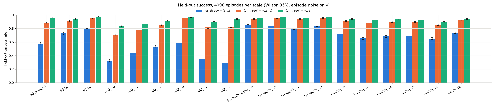
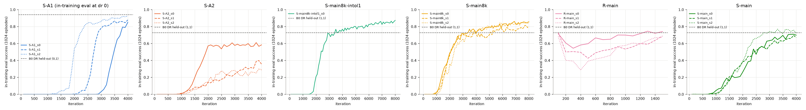
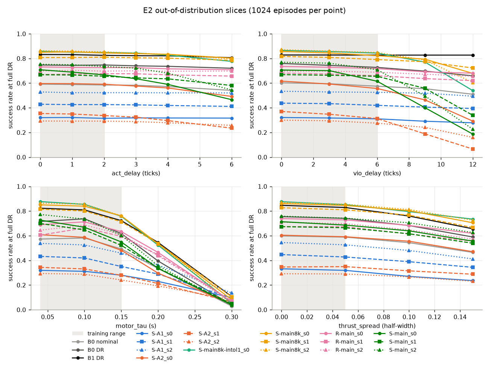
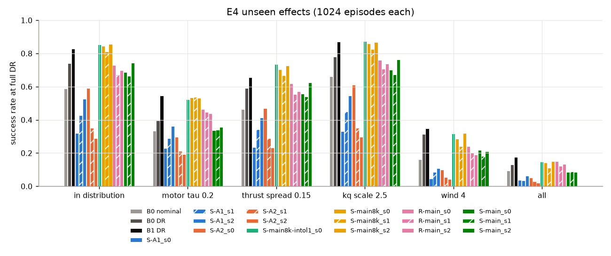

# Drone policy

A PPO policy that catches a thrown quadcopter and holds it at a hover target, trained and deployed
in Elodin. Each episode throws the stock Talon quad from [examples/drone](../drone) at a random
attitude, rate, velocity and offset; the controller has 5 s to reach the target and must stay inside
the success tolerances for the final 1 s ([env.py](env.py), [dr.py](dr.py)). Plant, sensor and
latency parameters are randomized per episode (DR). The policy sees only what the vehicle could
measure: an in-graph MEKF attitude estimate, the gyro, and a VIO-style position and velocity stream.
The baseline is a cascade whose gains were tuned by random search under the same randomization.
Everything here is simulation; nothing has flown.

## Results

4096 held-out episodes per scale, deterministic, with the same reset keys for every row, so
controller differences are paired per episode. (1, 1) is full DR and throws; (0, 1) is the nominal
plant with full throws. Full tables: [results/summary.md](results/summary.md) and
[results/results.json](results/results.json).

The checkpoints and B0 gains are the originals from 806b077: trained and tuned before `six_dof`
had the gyroscopic term ([#931](https://github.com/elodin-sys/elodin/pull/931)), before
`drone_init` clipped Izz, and with a 101-step success window (now exactly the last 100). Every
number here is flown on main plus [#944](https://github.com/elodin-sys/elodin/pull/944),
except where marked 806b077. They were not retrained: on 806b077, an eval-only effect equal to
the gyroscopic term changed full-DR success by 0.000 to 0.018 on 1024 episodes (S-main8k 0.840 to
0.836, the shipped seed 0.854 both times, B0-DR 0.746 to 0.741), and retraining PPO without
re-tuning B0 would tilt the comparison.

| controller | success at (1, 1) | crashed | vs B0-DR, paired | (0.5, 1) | (0, 1) |
| --- | --- | --- | --- | --- | --- |
| PPO, 3 seeds (S-main8k) | 0.825 [0.761, 0.889] | 0.034 | +0.099 [+0.035, +0.163] | 0.949 | 0.961 |
| PPO, shipped seed (S-main8k_s2) | 0.841 [0.830, 0.852] | 0.038 | +0.115 ± 0.007 | 0.955 | 0.966 |
| B1-DR: B0-DR fed true state | 0.810 [0.798, 0.822] | 0.081 | +0.084 ± 0.005 | 0.953 | 0.975 |
| B0-DR: cascade tuned under DR | 0.727 [0.713, 0.740] | 0.106 | reference | 0.912 | 0.939 |
| B0 nominal: tuned on the nominal plant | 0.577 [0.562, 0.592] | 0.080 | -0.150 ± 0.007 | 0.880 | 0.962 |

The 3-seed row gives t 95% intervals over seeds (seed SD 0.026). Single runs give Wilson 95%
intervals, which count episode noise only, and ± is the standard error of the paired difference.
Crashed means terminated at (1, 1): the drone fell too low or flew too far.

- Each seed beats B0-DR at (1, 1) by 0.069 to 0.115 on the same episodes. The learned policy crashes
  in 3.4% of episodes against 10.6%, under a third as often. Its other misses survive without
  holding the final window: 0.121 to 0.174 of episodes, against 0.167 for B0-DR.
- At (0.5, 1) the lead over B0-DR is 0.037 [0.015, 0.060]. On the nominal plant it is 0.022
  [0.000, 0.043], only 0.015 [-0.004, +0.034] on fresh episodes. There B0 nominal, the cascade
  tuned for that plant, scores 0.962, level with the seed mean (0.961; seeds 0.951 to 0.966), and
  on the fresh episodes it is ahead of every seed (0.975 against 0.955 to 0.968).
- B1-DR runs the B0-DR gains, not retuned, on true attitude, rates, position and velocity: a
  privileged reference, not an upper bound. At (1, 1) the policy is within noise of it (+0.015
  [-0.049, +0.079]; two seeds above, one below), and 0.005 to 0.014 below it at the lower scales
  (0.013 to 0.017 on fresh episodes).
- The 4000-iteration recipe's learning rate and iteration count, the residual variant and the
  shipped seed were chosen on these seed-20011 episodes (B0-DR's gains on separate ones). On 4096
  fresh episodes (seed 31337) that played no part in any choice, the policy scores 0.822 against
  0.727, a gap of 0.096 [0.024, 0.167], and the selected runs' gaps moved by -0.007 to +0.007,
  within episode noise ([results/replicate_seed31337](results/replicate_seed31337/summary.md)).
  The shipped seed, best of three here, is a near-tie with seed 0 (7 more successes of 4096) and
  scores 0.840 on the fresh episodes.



## Observations and actions

The actor reads 19 floats computed in the graph at the end of each 300 Hz tick
([policy_io.py](policy_io.py)): the body-frame up vector from the attitude estimate (roll and pitch
only), the gyro (rad/s, body FLU, biased, 40 Hz biquad), VIO position error and velocity in the
heading frame, a clipped integral of the position error, and the previous action. Truth and the DR
parameters go only to the critic (61 floats). The estimate comes from mekf6
([mekf6.py](mekf6.py)), a 6-state MEKF on the sim gyro, accelerometer and magnetometer, so training
has the estimator in the loop. The action is 4 numbers in [-1, 1] at 100 Hz, held for 3 ticks:
body-rate setpoints (times 3, 3 and 1.5 rad/s) and a collective of 0.689509 + 0.311 a[3], clipped to
[0.1, 1.0]. A rate PID and the examples/drone mixer close the loop at 300 Hz, with rate gains
scaled per axis by U(0.8, 1.25).

## What the ablations show

S-A1 and S-A2 each change one setting of S-main, the same recipe at 4000 iterations (0.695 at
(1, 1), seed SD 0.043). S-A1 and two S-A2 seeds were still improving at 4000, so these compare at
that budget, and per-seed paired differences are given because three seeds make wide intervals.

- **DR.** Trained on the nominal plant (S-A1, throws still random), the policy reaches 0.432 at
  (1, 1), 0.263 below S-main [0.044, 0.481], or 0.364, 0.215 and 0.209 per seed. Every seed is
  also worse on the nominal plant it trained on, by 0.031 to 0.077.
- **Estimator in the loop.** S-A2 trains on true attitude. Flown on mekf6, which is what the
  vehicle has, it reaches 0.320 (seeds 0.477, 0.292, 0.190), 0.215 to 0.548 below S-main per seed.
  Swapping its observations from truth to mekf6 alone costs 0.091 [0.026, 0.156] at (1, 1) and about
  0.3 at the lower scales; flown on truth, its training input, S-A2 also trails S-main (0.411
  against 0.695), so not all of its gap is the estimator. Conversely, S-main8k flown on true
  attitude gains 0.029 [0.018, 0.039] at (1, 1), 0.013 [0.001, 0.024] at (0.5, 1) and 0.010
  [-0.007, +0.027] on the nominal plant: what estimator error costs it in sim.
- **Budget.** 8000 iterations, with the learning-rate decay stretched to match, took S-main from
  0.695 to 0.825: +0.131 [0.069, 0.192] paired, 0.102 to 0.147 per seed, +0.124 on fresh episodes.
  Iterations and schedule changed together, and the curves below still creep up at 8000.
- **Residual.** A residual over B0-DR trained for 1500 iterations (R-main) did not improve on it:
  0.686, or -0.040 [-0.118, +0.038]. A 3000-iteration single-seed variant scored lower (0.677 on
  806b077). R-main had 49M env steps against S-main8k's 262M, and different hyperparameters, so it
  says nothing about residual against from-scratch training.
- **Not in the table.** A single seed with a 4x in-tolerance reward weight scored 0.851 at (1, 1)
  but crashed 1.6 times as often (5.5% against 3.4%) and trailed the 3-seed mean at the lower
  scales (0.943 and 0.948 against 0.949 and 0.961). An earlier recipe (reward v2, default critic
  initialization, 1500 iterations) reached 0.006 on a 2048-episode check on 806b077; too much
  changed after it to blame the reward.



## Robustness

E2 and E4 run at full DR on the first 1024 held-out episodes (B0-DR scores 0.741 there), and the
S-main8k numbers are seed means.

- **E2, one parameter past its training range.** At 6 ticks (20 ms) of extra action delay, against
  0 to 2 in training, S-main8k drops from 0.840 at 0 ticks to 0.795 and B0-DR from 0.747 to 0.721.
  VIO delay erases most of its lead: 0.848 falls to 0.669 at 12 ticks (40 ms; training 0 to 6;
  seeds 0.605 to 0.723), about level with B0-DR (0.659), while B1-DR on true position holds 0.827.
  At a motor time constant of 0.3 s (training 0.04 to 0.15 s) every controller fails: 0.081 for
  S-main8k, 0.040 for B0-DR.
- **E4, four parameters past their training ranges, alone and together:** motor tau 0.2 s, thrust
  spread ±15%, reaction torque x2.5 and wind 4 m/s (training stops at 0.15 s, ±5%, x2 and 2 m/s).
  A 4 m/s wind costs most and is the one case where the S-main8k mean falls below B0-DR: 0.283
  against 0.314 (seeds 0.242 to 0.320; B1-DR 0.348). All four at once: S-main8k 0.135, B0-DR
  0.131, B1-DR 0.175.





## Deploy inside Elodin

[policy_system.py](policy_system.py) runs a policy as an `el.System` at the head of the 300 Hz
chain, acting on the first of every 3 ticks like the training env. [main.py](main.py) flies N
thrown drones with the shipped policy in [policy/](policy) (S-main8k seed 2), on Cranelift unless
`DRONE_BACKEND=jax-cpu`. Sim-to-sim parity against the JAX training env and the speed of both
backends (results.json `e6`):

- 1 drone on Cranelift: max position difference 1.4e-5 m over 300 ticks. Over 256 held-out
  episodes of 1500 ticks, success and crash labels agree on 256 of 256 (226 successes each side),
  and the max position difference has median 8.9e-7 m, p90 3.3e-4 m and max 4.3e-3 m.
- 16 drones in one Cranelift world against 16 vectorized env episodes: 16 of 16 labels agree,
  median 1.2e-6 m. The same world on jax-cpu stays within 8.0e-5 m of the Cranelift run.
- `bench.py --world 1,16 --ticks 1500`, median 3-tick step: 1 drone takes 0.030 ms on Cranelift
  (334x real time) and 1.30 ms on jax-cpu (7.7x), 43x faster on Cranelift. 16 drones take 12.1 ms
  on Cranelift (0.83x real time) and 1.41 ms on jax-cpu (7.1x), 8.6x faster on jax-cpu.

Cranelift's step time jumps 44x from 1 drone to 2, then about doubles with each doubling (0.03,
1.33, 2.66, 5.44 and 12.43 ms at 1, 2, 4, 8 and 16 drones, 300 ticks each), while jax-cpu stays at
1.33 to 1.47 ms, so the two are level at 2 drones and jax-cpu is ahead from 4 up. In a profiled run
(`ELODIN_CRANELIFT_DEBUG_DIR`, slower per tick than the bench), about half of each multi-drone
tick is one pointer-ABI function, `mekf6_update` over the [N, 6, 6] covariance: 328 µs per tick at
2 drones and 2.33 ms at 16, where one drone's whole tick takes about 10 µs. That is a backend
performance gap this example does not fix; until it closes, set `DRONE_BACKEND=jax-cpu` for 4 or
more drones.

`evaluate.NumpyPolicy` runs the exported policy with numpy alone. It matches the JAX float64
forward to 1.0e-15 (1.7e-15 at worst over 16 policies) in a median 6.00 µs per call (p99 9.6 µs),
timed on the x86 workstation without elodin-db I/O, with a 1-min load average of 18 to 23.
Training throughput (`e10`): 453,230 env steps/s in a 1024-env rollout, 75.5 simulated flight
hours per wall minute; in the original runs on 806b077, S-main8k's PPO loop ran at 120k to 130k
steps/s with two runs sharing the machine.

## Reproduce

One 32-core x86 machine, 8 XLA host devices per job, run from the repository root. The numbers
above used an editable elodin at main 7bfa4493 plus
[#944](https://github.com/elodin-sys/elodin/pull/944); the released 0.20.0 predates #931,
#936 and #938, and env.py needs `JaxSim.step_fn` from #936, so training and evaluation do not run
on it. The checkpoints and training times are from the original runs on 806b077; train.py on main
trains with the gyroscopic term and the Izz clip, so the training commands below give new
checkpoints, not the evaluated ones.

```sh
# the shipped policy (S-main8k seed 2): 2381 s, sharing the machine with a second run
python examples/drone-policy/train.py --estimator mekf6 --dr curriculum --throw curriculum \
    --curriculum-iters 300 --iters 8000 --num-envs 1024 --steps 32 --devices 8 \
    --eval-every 100 --eval-envs 1024 --final-eval 1,1 0.5,1 0,1 --final-eval-envs 4096 \
    --final-eval-seed 20011 --lr 1.5e-4 --lr-end 3e-5 --ent-coef 1e-3 \
    --init-std 0.1,0.1,0.1,0.2 --in-tol-weight 0.25 --critic-head-gain 0.01 \
    --actor-warmup 20 --seed 2 --out runs/policy_s2

# every run in the tables, two at a time ($PYTHON picks the interpreter)
GRID=t3 examples/drone-policy/train_grid.sh   # S-main, R-main: 37 min, ~/drone-policy-runs/t3
GRID=t4 examples/drone-policy/train_grid.sh   # S-main8k*, S-A1, S-A2: 2 h 10 min

# all sections and figures: 1303 s (e1 also writes heldout_episodes.npz, about 1 MB, git-ignored)
python examples/drone-policy/evaluate.py all --runs ~/drone-policy-runs/t4 ~/drone-policy-runs/t3 \
    --e6 S-main8k_s2 --out examples/drone-policy/results
# the fresh-episode replicate: 245 s
python examples/drone-policy/evaluate.py e1 --seed 31337 \
    --runs ~/drone-policy-runs/t4 ~/drone-policy-runs/t3 \
    --out examples/drone-policy/results/replicate_seed31337

pytest examples/drone-policy/tests   # --runslow adds the eval harness and long parity runs

# time 1 and 16 drones on both backends
python examples/drone-policy/bench.py --world 1,16
# fly the shipped policy; main.py's docstring lists the DRONE_* settings
DRONE_N=4 elodin editor examples/drone-policy/main.py
```

## Elodin version

Main has all but one of the SDK fixes this example needed.
[#936](https://github.com/elodin-sys/elodin/pull/936) has the Exec.run, JaxSim, Cranelift SSA-id
and mekf fixes, and [#938](https://github.com/elodin-sys/elodin/pull/938) fixed the Cranelift
miscompiles in [#922](https://github.com/elodin-sys/elodin/issues/922) and closed it.
[env.py](env.py) steps the world with `JaxSim.step_fn` from #936 under `lax.scan`. The missing one
is [#944](https://github.com/elodin-sys/elodin/pull/944), which multi-drone Cranelift worlds
need: on the pointer ABI, a gather with indices batched over entities read the wrong elements, so
with 2 drones the motor model's lookup into its 120-point thrust curve put `motor_rpm` 100 to 200
rpm off from the first tick. One-drone worlds do not need it. The vehicle configs moved from
`examples/drone/main.py` to [vehicles.py](../drone/vehicles.py) so this example can import them.

## Limitations

- One simulated vehicle, the stock Talon: 2.586 kg, full-throttle thrust-to-weight about 1.33. DR
  was narrowed so the worst draw keeps about 1.15: mass x U(0.9, 1.1), per-motor thrust
  x U(0.95, 1.05), motor time constant 0.04 to 0.15 s, per-axis inertia x U(0.8, 1.2) with Izz
  clipped to Ixx + Iyy, the rest in [dr.py](dr.py). The hover collective, trim and observation
  scaling are fitted to this vehicle.
- The VIO stand-in ([vio.py](vio.py)) is truth plus a per-episode bias up to 2 cm per axis and
  white noise (sigma up to 2 cm and 5 cm/s), at 30 Hz, delayed 0 to 20 ms; yaw is truth plus 0.5 deg
  of noise. No drift, scale error, dropouts or frame misalignment.
- Latency is a 100 Hz hold plus 0 to 2 ticks (0 to 6.7 ms) of action delay: no jitter, no dropped
  messages, and inference takes no sim time.
- mekf6 is the roci-adcs filter math with its own sim tuning, on clean sim sensors (median tilt
  error 0.92 deg on 806b077); the sim magnetometer sees a horizontal unit field with no
  inclination.
- Three seeds per config, ablations at a 4000-iteration budget they had not converged in, and one
  residual recipe, which did not beat B0-DR (0.686 against 0.727).

## What is missing for Aleph

Nothing here has run on hardware. Before it can:

- **Actuator path.** The policy outputs rate setpoints and a collective for a rate loop and mixer
  Aleph does not have. The only Orin-to-MCU message is `Command { gpios: [bool; 8] }`, and
  sensor-fw writes one CRSF throttle to all four DShot outputs
  ([command.rs](../../fsw/sensor-fw/src/command.rs), [main.rs](../../fsw/sensor-fw/src/main.rs)).
  Betaflight 4.5, which the Aleph docs describe flashing, would close the inner loop with a
  different rate controller and stop the elodin IMU and MEKF pipeline.
- **IMU frames.** `imu.gyro` is raw deg/s at about 770 Hz, labelled FRD, with per-chip sign flips
  ([x, y, -z] on I2C, [-x, y, z] on SPI, both determinant -1). The policy wants rad/s in body FLU
  behind a 40 Hz biquad. The physical frame needs a tilt-and-rotate test on the vehicle.
- **fsw/mekf configuration.** With the service's shipped sigmas and no accel gate, mekf6 breaks the
  shipped policy in sim: on 806b077, 0 of 4096 held-out episodes succeed and all terminate, and
  the accel sigma alone is enough to do it. The service also runs at about 770 Hz with a fixed dt
  of 1/800 s, and `aleph.q_hat`'s frame convention is unverified.
- **VIO and ROS bridge.** Nothing supplies position, velocity or yaw: elodin-db has no VIO
  component and the elodin repo has no ROS 2 or ZED code. An adapter must also reproduce the
  position integral exactly, integrated every 300 Hz tick on the held VIO error.
- **Latency and thrust.** The Orin loop latency is unmeasured (the 6 µs is x86), and nobody has
  checked the sim Talon's T/W of 1.33 against the real motors and props.
- **Safety and scope.** sensor-fw has no RC link-loss failsafe (`CrsfReceiver::is_connected` has no
  caller), and the task is recovery to one hover point.
