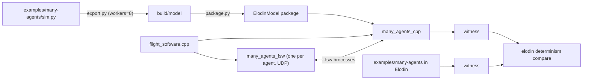

# Many agents in C++

The [many-agents](../many-agents) SITL as one standalone C++ program. Each agent's flight
software is C++, the simulation step is exported from Elodin and runs on worker threads, and a
small C++ host recreates the parts of Elodin's tick loop the SITL needs. The host writes Elodin's
deterministic witness format, so Elodin's own tools prove that it reproduces the Elodin run
byte for byte, every tick, and that it repeats exactly.

The [Custom C++ Runtimes](https://docs.elodin.systems/reference/cpp-runtime/) reference covers
the workflow in general, with [ball-cpp](../ball-cpp) as the smallest case.



## Run it

From the repository root, inside `nix develop` after `just install`:

```sh
bash examples/many-agents-cpp/run.sh            # 4 agents, 600 ticks
bash examples/many-agents-cpp/run.sh 24 1000    # the original's 24 agents
```

That builds everything and runs every check below. Generated files go to
`examples/many-agents-cpp/build/`.

## From Elodin to C++

| In Elodin's many-agents | In this example |
| --- | --- |
| `sim.py` systems, run by `World.run(workers=8)` | `build/model`, exported from the same `sim.py` and linked as `libelodin_model` |
| The Rust controller, one process per agent | [`flight_software.cpp`](cpp/flight_software.cpp), called in-process or run as [`many_agents_fsw`](cpp/fsw_main.cpp) processes |
| The native `pre_commit` hook that exchanges UDP packets | [`exchange.cpp`](cpp/exchange.cpp) |
| The tick loop, real-time pacing and run receipt | [`main.cpp`](cpp/main.cpp) and [`pacing.hpp`](cpp/pacing.hpp) |
| Process recipes: start, wait, SIGTERM then SIGKILL | `ProcessExchange` in [`exchange.cpp`](cpp/exchange.cpp) |
| Deterministic witness | [`witness.cpp`](cpp/witness.cpp) and a portable [`blake3.cpp`](cpp/blake3.cpp) |

The C++ host has no Elodin DB, editor, telemetry or camera history. It runs what the `lockstep`
mode runs: the simulation step, then every agent's flight software, then the commands it
returns, at 1 kHz.

### 1. The flight software

[`protocol.hpp`](cpp/protocol.hpp) is the packet layout of
[`protocol.py`](../many-agents/protocol.py): a 1024-byte state packet per agent and a 104-byte
reply. `FlightSoftware::step` answers a state packet with PD guidance toward the object the
agent follows, saturated at 12 m/s².

`many_agents_fsw STATE_PORT COMMAND_PORT AGENT` takes the same arguments as the Rust
controller, so it drops into the unchanged Elodin example:

```sh
ELODIN_MANY_AGENT_CONTROLLER_BIN=examples/many-agents-cpp/build/install/bin/many_agents_fsw \
  elodin run examples/many-agents/main.py
```

`verify.py` runs exactly that and checks the witness root equals the run with the Rust
controllers.

The C++ is compiled with `-ffp-contract=off`. Without it, clang on arm64 fuses
`1.4 * position_error + 0.45 * velocity_error` into one fused multiply-add, which rounds once
instead of twice. The very first reply then differs from the Rust controller's in its last bit,
and the comparison names that byte.

### 2. Export the step

```sh
python3 examples/many-agents-cpp/export.py --agents 24 --workers 8
```

`export.py` imports [`examples/many-agents/sim.py`](../many-agents/sim.py) unchanged and calls
`world.export_model(system, workers=8, interfaces={"agents": ...})`. The optional passive
interface retains the position, velocity, and writable command rows without prescribing this
host's loop. `workers` matters for bits, not only for speed. With more than one worker, Elodin
traces each `@el.map` system in chunks of two entities so the chunks can run in parallel, and a
chunked sum can round differently from a whole-column one. Exporting with `workers=8` therefore
matches `World.run(workers=8)`.

The object `export_model` compiles keeps those chunks as groups of independent calls. The
library runs them on a pool of worker threads; `--workers` sets the thread count, and the
results do not depend on it.

### 3. Package and build

```sh
python3 libs/elodin-model/package.py examples/many-agents-cpp/build/model examples/many-agents-cpp/build/ElodinModel
cmake -S examples/many-agents-cpp/cpp -B examples/many-agents-cpp/build/cpp \
  -DElodinModel_DIR="$PWD/examples/many-agents-cpp/build/ElodinModel"
cmake --build examples/many-agents-cpp/build/cpp
```

The packaging is the same as in [ball-cpp](../ball-cpp). The host finds components by name and
each row's entity with `elodin_model_component_rows`, `elodin_model_entity_id` and
`elodin_model_entity_name`.

### 4. Run it

```sh
examples/many-agents-cpp/build/cpp/many_agents_cpp --ticks 20000 --receipt receipt.json
examples/many-agents-cpp/build/cpp/many_agents_cpp --fsw processes --witness run.witness
```

Each tick runs in Elodin's order:

1. Step the simulation.
2. Send every agent its state packet and take back the commands, written to `command` for the
   next step.
3. Decide which rows changed and record them.
4. Wait for the next millisecond, unless `--realtime 0`.

`--help` lists the options, including `--csv`, `--workers` and a one-bit fault
(`--fault-tick`, `--fault-agent`, `--fault-byte`).

### 5. Verify against Elodin

```sh
python3 examples/many-agents-cpp/verify.py --bin examples/many-agents-cpp/build/install/bin --agents 24 --ticks 1000
```

`verify.py` runs the original example in `lockstep` mode with a raw witness, then checks:

| Check | What it proves |
| --- | --- |
| Elodin with `many_agents_fsw` has the same root as with the Rust controllers | The C++ flight software decides exactly what the Rust controller decides |
| The C++ host, flight software in-process, is identical to Elodin | The host reproduces the Elodin run byte for byte: every field, packet, reply and commit |
| The same with one flight-software process per agent | The UDP transport changes nothing |
| A second C++ run is identical to the first | The C++ run is deterministic |
| A run with `--workers 1` is identical | Thread count and scheduling do not change the results |
| A one-bit fault is found at its tick, record, agent and byte | The comparison finds real differences, and where they are |
| Elodin's native hook replays the C++ witness | Elodin's own hook, given the C++ run's inputs, builds the same packets and commands |
| The CSV equals the positions, velocities and commands Elodin recorded | The same result outside the witness, also plotted in `build/verify/trajectories.png` |

## The witness

Elodin's witness records, at every tick, the exact bytes of chosen fields and hook channels at
each stage of the tick, and hashes them into a BLAKE3 tree whose root covers the whole run. Two
runs with the same root did the same thing to the last bit; when roots differ,
`elodin determinism compare` reads the files and reports the first tick, stage, record, entity
and byte that differ.

[`witness.cpp`](cpp/witness.cpp) writes the format of
[`libs/nox-py/src/witness`](../../libs/nox-py/src/witness) for the batches the Elodin example
witnesses, four stages a tick:

- **after the systems:** each agent's state and the object it follows;
- **after the exchange:** the state packets, the replies' values, the commands, and the
  replies themselves;
- **after the second hook:** the commands again;
- **after the commit:** which rows the commit recorded.

The commit flags are the subtle part. Elodin's DB records a row only when its bytes differ from
the last value recorded for it, so the host keeps the last recorded value of every row and
compares each tick.

The schema in the header must be byte for byte what Elodin's serde writes, because Elodin checks
its digest when it opens the file. The hooks are labeled with the Elodin hook names, so
`elodin determinism replay-hook` can replay the original native hook from a C++ witness.

```sh
cd examples/many-agents-cpp/build/verify
elodin determinism compare elodin.witness cpp-in-process.witness
```

## Measured

24 agents, 20000 ticks paced at 1 kHz, on an Apple M2 Max (macOS):

| Run | Step mean / p95 | Exchange mean / p95 | Late ticks |
| --- | --- | --- | --- |
| C++ host, 8 workers, flight software in-process | 270 / 355 µs | 3 / 8 µs | 1 (0.01%) |
| C++ host, 8 workers, 24 flight-software processes | 299 / 377 µs | 288 / 344 µs | 147 (0.7%) |
| C++ host, 1 worker | 1409 / 1451 µs | 2 / 4 µs | all: cannot keep 1 kHz |
| Elodin, `lockstep`, 8 workers, 24 controller processes | 270 / 334 µs | 281 / 320 µs | 0 |

The step is the same compiled code in both, so it costs the same. Calling the flight software
in-process removes the UDP round trips, which are most of a tick when it runs as processes.

## Limits

- `step.o` targets the machine that exported it, as in [ball-cpp](../ball-cpp).
- The witness proof covers the `lockstep` mode: the step, the exchange and the commits. The
  camera history and deferred writes of `lockstep-history` and the DB are not reproduced.
- The model has the agent count it was exported with; re-export for another.
- The flight-software processes listen on 127.0.0.1 ports from `--port-base`, two per agent.
