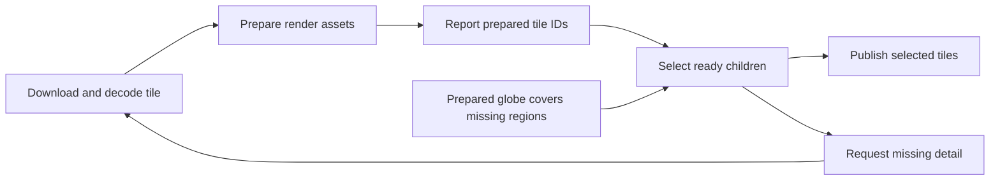

# Progressive terrain experiment

This proof of concept starts from Elodin PR #987 at
`f26aa5e9ca6f6c10e2e5586e2e4398b45f92160e`.
It displays prepared terrain in successive regions and requests nearby tiles
first. It provides a separate `elodin-web-progressive` Nix package.
The normal `elodin-web` package keeps its existing behavior.

## Terrain selection and rendering

The Rust `tiles-core` loader selects terrain tiles. Bevy prepares their meshes,
textures, and materials separately. A decoded tile can therefore still need
render preparation before it can appear.

The renderer sends prepared tile IDs back to the selector before each update.
Without background coverage, the selector keeps a covering parent until its
required replacement children are ready. This prevents missing regions.

The editor marks the existing globe primitives with `CesiumCoverageFallback`.
In default mode, once every marked primitive has prepared render assets, the selector can publish
ready children independently. The globe covers regions that are still loading.
A replacement parent does not overlap its selected descendants. Removing the
background disables partial coverage.

For example, Alice sees two regions, A and B. One detailed child for A is ready.
Its siblings and the children for B are still preparing. Alice can see that
ready child while the globe covers the remaining areas. Other tiles appear as
their render assets become ready.



Imagery can replace an existing tile without changing its ID. The old prepared
version stays visible while the new version prepares. The renderer removes the
old entities when it promotes the replacement. A pending replacement does not
block another ready region.

Decoded tiles remain resident while their render assets prepare. Unused
ancestors can still be evicted under the existing cache policy. Capture
readiness remains strict: pending requests, missing desired detail, and pending
render replacements prevent a completed capture.

Prepared render assets do not guarantee that pixels reached the screen.
A GPU fence is a signal that the graphics processor finished work.
This experiment does not provide that signal.

## Closest-first requests

Prepared files retain priority over provider requests. Within each group, the
loader sorts queued requests by distance from a viewing camera to each tile's
bounding sphere. Screen-center alignment breaks equal-distance ties. Distance
to the sphere center breaks remaining ties. Identical priorities retain their
previous order.

This is a distance-first subset of
[Cesium Native's camera-aware priority policy](https://cesium.com/learn/cesium-native/ref-doc/selection-algorithm-details.html#load-prioritization).
It does not copy the full scheduler or its exact angular weighting formula.
Bounding spheres already approximate the tile geometry, so the distance is an
estimate of distance to the actual terrain surface.

Each queued tile's score is computed once per update, using cameras that can
see its bounds. The order changes when the camera moves. Requests already
downloading continue. Concurrent requests can finish in a different order
because download, decode, and render preparation costs differ.

The experimental loader allows twelve jobs, with at most nine provider jobs.
Three slots remain available for prepared files when provider work is busy.
One shared limit sizes the completion queue and caps admitted tile jobs.
Every outstanding job can therefore finish before the next frame drains the
queue, without losing its result. The browser keeps non-blocking delivery.
Texture resolution, decoding, shader compilation, and the unused-cache budget
also remain unchanged. Active tiles and render preparation still use memory
outside the unused-cache budget.

## Delivery and coverage-first experiment

The default remains closest-first. Add `terrain_order=coverage` to the browser
page URL to enable progressive-resolution priority. The coarse target uses the
existing screen-space error calculation at 30% of each view's height.
Screen-space error estimates geometric error in pixels.

The priority classification follows CesiumJS's
[`isPriorityProgressiveResolution`](https://github.com/CesiumGS/cesium/blob/9eb72b69f7e8559a4ac07cddf735e9a2bdae567c/packages/engine/Source/Scene/Cesium3DTile.js):
prioritize ancestors that exceed the coarse target and the boundary tiles that
first meet it. Finer descendants come afterward. A tile that is fine enough for
a distant camera can still need the coarse-priority group for a closer camera.
Recompute the classification when views change. Parent indices are cached and
rebuilt when a root is replaced or a hierarchy document adds nodes.

The exact request ranking in coverage mode is:

1. Coarse-target group before finer work.
2. Known hierarchy documents before meshes within that group.
3. Shallower mesh depth before deeper mesh depth.
4. Distance to bounds, screen alignment, then center distance.

Package and provider files share this ranking. This ports CesiumJS's priority
classification, not its full scheduler. In particular, the within-group
shallow-first policy, hierarchy handling, and job limits are this experiment's
choices. It does not implement CesiumJS foveation, dynamic error adjustments,
or its numeric priority packing. It is a priority policy, not a global barrier
that prevents every fine request until every coarse tile is rendered.

Coverage mode also retains a prepared coarse parent until all visible
replacement children can be published together. A single ready detailed child
must not remove the ground covering its unready siblings. Regions can still
refine independently when their own replacement coverage is ready. This trades
some early fine detail for continuous ground coverage and avoids drawing
overlapping replacement parent and child meshes. Additive refinement keeps its
existing behavior. The default mode retains independent
child publication over the globe backdrop.
While a parent covers a missing region, requests for finer detail in its
already covered children wait. Those requests resume when coarse replacement
coverage is ready. Coverage mode also skips the package-only selection pass:
ignoring absent provider regions there would incorrectly mark them covered
and remove the parent. Default mode keeps that prepared-detail fallback.
It preserves the covering-parent and prepared-backdrop
rules. A caller that owns a `tiles_core::Session` can set `coverage_first`
directly. Neither ordering changes the number of jobs in flight.

Within each priority group, coverage mode puts visible hierarchy documents
before mesh requests. A hierarchy document reveals deeper tile addresses; a
world-scale mesh can look like a flat colour from a camera near the ground.
Loading nearby hierarchy documents first therefore reaches recognizable local
ground without waiting for every shallower mesh. Known `.json` content URLs
receive this discovery priority. Other content keeps its normal mesh priority.
When a mesh is waiting, at most two hierarchy requests can be in flight, so
discovery leaves capacity for terrain that can actually be drawn, including a
provider mesh under the nine-provider-request limit. When no mesh
is waiting, hierarchy discovery can use all twelve slots. The provider
limit still applies. Fine hierarchy discovery cannot outrank a missing
coarse-target mesh solely because it is a document. Default mode retains
prepared-file priority. Requests
already in flight continue. Closest-first mode keeps its existing behavior.

### Optional browser audit

Set `window.__elodinTerrainAudit` to a function before starting the editor to
observe request admission and selected mesh IDs. The callback receives
`(kind, timestampMilliseconds, payload)`. With no callback, audit arrays are
not constructed. The observer should bound its own storage.

For `request`, payload fields are `[id, parentIdOrMinusOne, depth,
geometricError, screenSpaceError, reducedScreenSpaceError, progressivePriority,
isHierarchy, isProvider, radius, maximumScreenError, heightFraction, url]`.
Boolean flags are represented as 0 or 1. URLs exclude queries and fragments.
The progressive flag is an admission-priority class, not a label for the
apparent texture detail. A false flag means normal priority.
The provider flag describes the loader's planned source; a later transport
fallback can change the actual network origin.
For `selection`, payload is `[Uint32ArrayOfSelectedIds, cameras,
selectionComplete]`. Each camera contains position XYZ, direction XYZ, and
view height. IDs are local to one session; the Falcon 9 capture uses one source.

The request priority flag describes the view at request time. Selected IDs can
be joined to request depths to identify the selected hierarchy levels. This is
not an exact pixel-to-tile mapping or a GPU presentation fence. A sharp rocket
model is independent of these terrain mesh records.

For prepared package files, the browser transport uses the optional host
function `window.__elodinFetchPackage(Request)`. The host returns a standard
`Response`, with the requested file's bytes and status. This allows authenticated
batch delivery and verified local caching without changing package URLs in the
recording. The normal browser fetch remains the default when no host supplies
the function. Provider requests always bypass this hook. Existing redirect,
timeout, body-size, offline, and provider-origin restrictions remain in place.

Concurrent first provider misses share one in-flight credential and root
bootstrap. Concurrent refreshes also share it; a late failure from an older
grant reuses the newer grant instead of refreshing again. A failed bootstrap
clears the in-flight state so a later request can retry. Offline packages never
start provider authorization.

## Patch layout

The terrain dependency remains pinned to `bevy-cesium` at
`f249789487e75be8372ddf465c41fc2d98275508`.
The experiment applies three patches during its separate Nix build:

- `tiles-core.patch` changes selection, request ordering, and regression tests.
- `bevy-cesium.patch` connects render readiness and background coverage.
- `elodin-editor.patch` marks the existing globe primitives as background coverage.

`apply.py` patches writable Cargo dependency copies and updates their per-file
vendor checksums. A checksum is a fingerprint of file content. The Nix package
includes only this helper and the patches, so documentation changes do not
invalidate the browser build.

`Cargo.toml`, `Cargo.lock`, and `flake.lock` retain their PR versions. Browser
and prepared-recording paths use the Rust loader. Live native sources continue
to use Cesium Native's scheduler.

## Build and run locally

Run commands from the repository root. Enter a named Nix development shell.
Install the Python SDK before building the DB binary:

```sh
ELODIN_SHELL_ID=terrain-progressive-poc nix develop
just install py
just install db
mkdir -p .local/terrain-progressive
nix build .#packages.aarch64-linux.elodin-web-progressive \
  --out-link .local/terrain-progressive/wasm --print-build-logs
```

The ARM64 Linux package needs a configured Linux builder when building on macOS.
Its JavaScript and WebAssembly output can be served on macOS. If the build
reports unresolved Git LFS pointers, run `git lfs pull` and rebuild.

Use a copy of a recording that includes prepared terrain and the globe asset.
For a Falcon 9 recording in Downloads, these macOS commands create a copy and
start the DB on TCP port 18440. Its asset and WebSocket server uses port 18441:

```sh
cp -cR "$HOME/Downloads/falcon9-db" .local/terrain-progressive/falcon9-db
elodin-db run 127.0.0.1:18440 .local/terrain-progressive/falcon9-db --log-level warn
```

Copy into a new destination only once. macOS copy-on-write cloning shares disk
blocks until data changes. The DB can update this copy when it opens it.

In another Nix shell, serve the experimental editor:

```sh
uv run --offline --no-project --python python3 python \
  experiments/terrain-progressive/serve.py .local/terrain-progressive/wasm
```

Open `http://127.0.0.1:18081/?offline=1` in Safari. No account is required.
`offline=1` uses the recording's prepared terrain. Remove that query to use
the recording's normal terrain policy.

To compare against the unchanged PR, build the baseline and serve it on port
18080. Keep the experimental server on port 18081:

```sh
nix build .#packages.aarch64-linux.elodin-web \
  --out-link .local/terrain-progressive/baseline
uv run --offline --no-project --python python3 python \
  experiments/terrain-progressive/serve.py .local/terrain-progressive/baseline --port 18080
```

The server helper applies the same Safari bloom-shader spelling workaround to
both pages. It leaves the compiled artifacts unchanged. It also records resource
timings, startup readiness, JavaScript errors, and animation-frame gaps.

## Reproduce the Rust checks

Inside the Nix shell, create a fresh editable copy of the pinned dependency.
Do not copy over an existing editable terrain directory. Apply the dependency
patches, then run its tests and Clippy:

```sh
terrain_source=$(nix eval --raw --expr '(builtins.fetchGit {
  url = "https://github.com/elodin-sys/bevy-cesium";
  rev = "f249789487e75be8372ddf465c41fc2d98275508";
  allRefs = true;
}).outPath')
cp -R "$terrain_source" .local/terrain-progressive/bevy-cesium
chmod -R u+w .local/terrain-progressive/bevy-cesium
uv run --offline --no-project --python python3 python \
  experiments/terrain-progressive/apply.py .local/terrain-progressive/bevy-cesium
RUST_TEST_THREADS=1 cargo test \
  --manifest-path .local/terrain-progressive/bevy-cesium/Cargo.toml -p tiles-core
cargo test --manifest-path .local/terrain-progressive/bevy-cesium/Cargo.toml \
  -p bevy-cesium --lib
cargo clippy --manifest-path .local/terrain-progressive/bevy-cesium/Cargo.toml \
  --all-targets -- -D warnings
```

For further dependency edits, change that copy and run
`update-patches.py "$terrain_source"` through `uv` in the same Nix shell.
This regenerates the two dependency patches. The editor patch is separate.

## Browser checks and evidence

`profile.py` captures visible Safari trials from ports 18080 and 18081.
Enable Safari remote automation and keep the Mac unlocked. Raise the automation
window if it starts hidden. The script rejects a window that stays hidden.
It writes screenshots and results to `.local/terrain-progressive/safari/`.

`chromium.py` provides an ARM64 headless rendering check. It needs Playwright
and a matching Python interpreter. Use `--chrome /absolute/path/to/chrome` to
select an installed browser. It writes results under
`.local/terrain-progressive/chromium/`.

The terrain-core suite passed all 44 tests, with one existing ignored test.
The renderer suite passed all 26 tests. Clippy, Ruff, and Alejandra passed.
An unchanged HTTP fixture intermittently returned `WouldBlock`, then passed
in isolation and in the complete serial rerun.

Tests cover independent child publication, complete-coverage fallback, prepared
background requirements, removal of the background, imagery replacement, cache
retention, capture readiness, nearest bounds, camera movement, and stable ties.
The first prototype retained a sibling barrier and still showed a large jump
in Safari. The background-coverage change removed that barrier.

In the closest-first Safari comparison, the landing pad and foreground were
textured at the approximately six-second screenshot while distant regions were
still filling. The previous ordering mostly showed distant tiles at that point.
This was one warm-browser pair with a fixed end-of-run camera. Screenshots add
overhead and cannot establish subsecond timings or a controlled startup speedup.
Individual tiles still appear abruptly. The experiment does not add blending.

The optional `window.__elodinTerrainFrames` array enables bounded counters.
When a profiler creates it, the loader records at most 6,000 rows. Each row
contains epoch milliseconds, selected tiles, pending requests, resident tiles,
prepared tiles, background readiness, selection completion, decoded tiles, and
total requests. It records no credentials or component values.
The closest-first trace recorded 622 updates, including 116 with visible tiles
while other requests remained pending. Local screenshots and recordings remain
outside Git.
