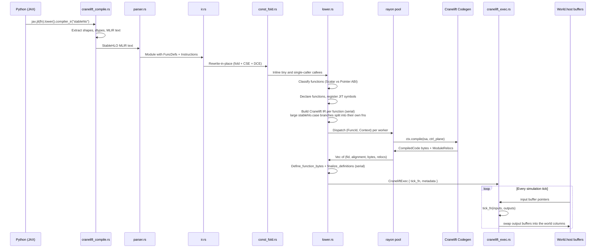
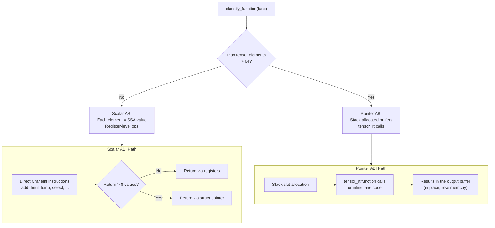
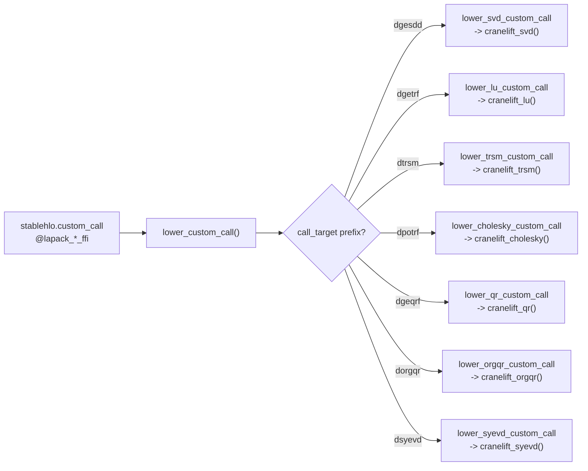
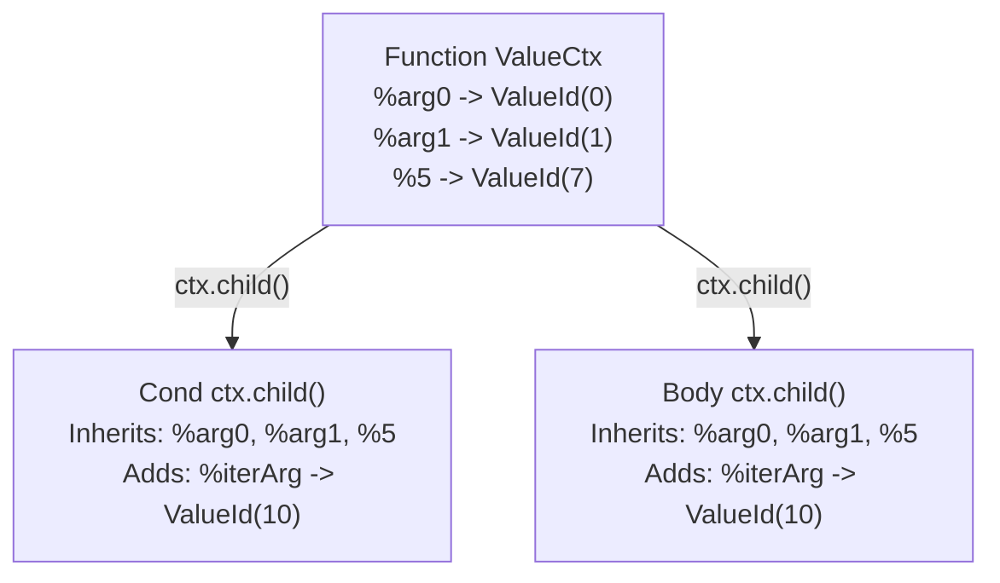

# cranelift-mlir Architecture

A Rust-native JIT compiler that transforms StableHLO MLIR into native machine code via
Cranelift, replacing IREE as the CPU execution backend for Elodin simulations.

## Table of Contents

1. [Motivation](#motivation)
2. [End-to-End Compilation Pipeline](#end-to-end-compilation-pipeline), including [parallel call groups](#parallel-call-groups-parallel-rs-pool-rs)
3. [Dual ABI Architecture](#dual-abi-architecture)
4. [SIMD: Packed-f64 Lane Representation](#simd-packed-f64-lane-representation)
5. [JIT Memory Layout](#jit-memory-layout)
6. [Tensor Runtime](#tensor-runtime)
7. [LAPACK via faer](#lapack-via-faer)
8. [Gather: The Hardest Op](#gather-the-hardest-op)
9. [While Loop Scoping](#while-loop-scoping)
10. [Checkpoint Diagnostic Tool](#checkpoint-diagnostic-tool)
11. [Testing Strategy](#testing-strategy)
12. [Supported Operations](#supported-operations)
13. [Known Limitations](#known-limitations)
14. [Opportunities](#opportunities)

---

## Motivation

Elodin simulations are **single-threaded, CPU-bound physics ticks** operating on small,
dense f64 tensors (typically 3-vectors, 4x4 matrices, 6x6 covariance matrices). Each
simulation tick applies a JAX-compiled function to the world state and writes the results
back.

The previous backend, IREE, is designed for large-scale ML inference across heterogeneous
hardware. For Elodin's workloads, IREE's runtime overhead dominates execution time:

- **~30 FFI boundary crossings** per tick (Python -> Rust -> IREE VM -> HAL -> kernel -> back)
- **VM dispatch**: IREE's bytecode interpreter dispatches each operation individually
- **HAL buffer management**: allocation, staging buffers, host-to-device/device-to-host copies
- **Buffer view wrapping**: every tensor access creates typed wrapper objects

The Cranelift path eliminates all of this. A single native function pointer is called
directly on the simulation's host memory buffers, with zero copies and zero dispatch overhead.

### Performance Results

All six regression examples pass with bit-for-bit or tolerance-matched correctness:

| Example | IREE RTF | Cranelift RTF | Speedup | Tensors |
|------------|----------|---------------|---------|---------|
| ball | 79x | ~10,000x | **~130x** | 3-vectors |
| three-body | 29x | ~4,700x | **~160x** | 3-vectors |
| drone | 2.9x | ~300x | **~100x** | 4-vectors, 3x3 |
| rocket | 2.3x | ~33x | **~14x** | 3-vectors, trig |
| linalg | 0.1x | ~800x | **~8,000x** | 6x6, SVD, LU, QR |
| cube-sat | 0.56x | ~3.6x | **~6.4x** | 65x65 (EGM08) |

RTF = Real-Time Factor (higher is better). Measured on Apple Silicon.

The speedup ranges from 6x (cube-sat, dominated by 65x65 matrix operations) to 8,000x
(linalg, where IREE's dispatch overhead per LAPACK call was extreme). The typical
small-simulation speedup is **100-160x**.

---

## End-to-End Compilation Pipeline



### Stage 1: Python to StableHLO

The Python SDK (`nox-py`) traces JAX functions and lowers them to StableHLO MLIR text.
This happens in `libs/nox-py/src/cranelift_compile.rs`:

1. The user's simulation systems are traced by JAX into HLO computation graphs
2. `jax.jit(fn, keep_unused=True).lower(*zero_inputs)` produces a lowered JAX computation
3. `.compiler_ir(dialect="stablehlo")` extracts the StableHLO MLIR as a text string
4. Input/output shapes and dtypes are extracted from the lowered computation metadata

The `keep_unused=True` flag is critical: it preserves all input/output slots even if JAX
determines some are unused, maintaining stable positional mapping between the simulation's
world columns and the function's arguments.

### Stage 2: Parsing (`parser.rs`, ~3,600 lines)

A Winnow-based parser converts StableHLO MLIR text into the internal IR. Key design
decisions:

- **Streaming parser**: processes one instruction at a time, no AST allocation for the
  full module
- **`ValueCtx` scoping**: each parsing context maps SSA names (`%0`, `%arg0`) to internal
  `ValueId`s. Region bodies (while, case, map, sort, ...) use `ctx.child()` to create child
  contexts that inherit the parent's mappings and share its id counter, so `ValueId`s stay
  unique per function (see [While Loop Scoping](#while-loop-scoping))
- **`backend_config` extraction**: LAPACK custom calls carry parameters like
  `{uplo = 76 : ui8, diag = 85 : ui8}` which are parsed into a `HashMap<String, i64>`
- **Dense constants**: a `dense<...>` literal becomes a scalar, splat or array constant. Hex
  blobs are decoded two characters at a time, and one over 1 MB goes to the constant cache
  (see [Constants live in the data section](#constants-live-in-the-data-section)). For a
  module that embeds a large lookup table this decoding is most of the compile time (see
  [Opportunities](#opportunities))

### Stage 3: Internal IR (`ir.rs`, ~780 lines)

A lightweight representation with these key types:

- **`Module`**: collection of `FuncDef`s
- **`FuncDef`**: name, parameters (with types), result types, body (list of `InstrResult`)
- **`Instruction`**: about 80 variants covering arithmetic, comparison, shape manipulation,
  control flow, indexing, LAPACK custom calls, and type conversion
- **`TensorType`**: shape (Vec of i64) + element type (F64, F32, I64, I32, UI32, I1, etc.)
- **`ConstantValue`**: `DenseScalar`, `DenseSplat`, `DenseArray`, or `DenseExternal`, a
  memory-mapped blob from the constant cache
- **`GatherDims`**: offset_dims, collapsed_slice_dims, start_index_map, index_vector_dim
- **`ScatterDims`**: update_window_dims, inserted_window_dims, the two batching dim lists, scatter_dims_to_operand_dims, index_vector_dim; `ScatterCombiner` is Set, Add, Multiply, Minimum or Maximum
- **`DotDims`**: contracting and batching dimension lists for `dot_general`
- **`ReduceOp`**: Add, Multiply, Minimum, Maximum, And, Or

### Stage 3.5: Constant folding (`const_fold.rs`)

An IR-to-IR rewrite that runs between parsing and lowering. Three rule
families cooperate under a bounded cascade loop per function:

1. **Shape and layout folds.** `BroadcastInDim` / `Reshape` / `Convert` /
   `Iota` over constants collapse into a single `Constant` — typically the
   compact `DenseSplat(scalar, shape)` form that the lowering pipeline
   already handles efficiently.
2. **Scalar arithmetic, bitwise, compare, select.** Unary and binary ops on
   `DenseScalar` or matching-shape `DenseSplat` operands evaluate at
   compile time. Float ops only fold when both inputs and the result are
   finite; integer `divide` / `remainder` refuse to fold with a zero divisor
   so the runtime handles those edge cases.
3. **Array folds and algebraic identities.** `Transpose` / `Reverse` /
   `Slice` / `Pad` / `Concatenate` / `DynamicSlice` on `DenseArray` /
   `DenseSplat` constants — each gated by a 1 KB byte-size cap so folding
   cannot explode compile-time memory. Identities (`x*1`, `x+0`, `x-0`,
   `x/1`, constant-cond `Select`, `select(c, x, x)`, no-op `Convert` /
   `Reshape` / `BroadcastInDim`) rewrite downstream operand references
   through a `ValueId` alias table; the now-unused instruction is removed
   by DCE.

After the identities, a `gather` whose operand is a `broadcast_in_dim` that
only inserts the gather's `operand_batching_dims` reads the broadcast's
source instead, with the batching dims dropped and the other operand dims
renumbered. `jax.vmap` emits that pattern for a lookup table shared by every
entity, usually behind the `select(pred, x, x)` of a vmapped `lax.cond`;
without the rewrite the pointer ABI would build one copy of the table per
entity. Two more rewrites remove layout work that joins across archetypes
emit: a `broadcast_in_dim` that only adds unit dims becomes a `reshape`, and a
row `gather` with constant, consecutive indices becomes a `slice` (a slice of
the whole operand is then an alias).

Common subexpressions are aliased to the first identical pure instruction in
scope. Instructions are bucketed by a hash of their kind, operands after
aliases, constant bits and result types; a match is confirmed bit for bit for
constants and by the full instruction otherwise. A `case` branch sees its
enclosing scope but not its siblings. `while`, `map`, `sort` and window bodies
start empty: the scalar ABI lowers a `while` body with only its iteration
arguments, and both ABIs compile the other regions as separate functions, so a
value from outside would not be reachable there. JAX emits StableHLO before any
optimizer has run, so duplicates are common: on a two-vehicle customer model 40%
of the instructions repeat an earlier one in scope.

A conservative DCE pass runs after each fold iteration, removing pure
instructions whose result `ValueId`s are no longer referenced anywhere in
the function (including nested `While` / `Case` / `Map` / `ReduceWindow` /
`SelectAndScatter` / `Sort` bodies). The fold+DCE loop iterates until it
reaches a fixed point or a hard cap of 8 passes.

Every invocation of `fold_module` emits a one-line summary
(`[elodin-cranelift] fold: N -> M instr (-K, -P.P%)`); enabling debug
mode additionally prints a per-rule histogram and the scalar-vs-pointer
ABI classification, for sizing the impact of future work.

Before lowering, `compile_module_with_config` inlines callees of at most 12
instructions, without regions or calls, at every call site in scalar-ABI
functions, including sites inside `case` and `while` bodies, when the callee is
scalar-ABI too. It folds the changed callers again, then inlines callees that
have a single call site at the top level of their caller (callee under 200
instructions, caller under 1,200).

### Stage 4: Lowering (`lower.rs`, ~12,000 lines)

The largest and most complex file. Transforms the internal IR into Cranelift IR and
produces a native function pointer. Codegen is organized into a three-phase pipeline
so Cranelift's per-function optimization (egraph, legalization, regalloc, machine
code emission) can be parallelized across a rayon thread pool:

1. **Function classification**: `classify_all_functions` determines Scalar vs Pointer ABI
   for each function (see [Dual ABI Architecture](#dual-abi-architecture))
2. **JIT symbol registration**: all runtime functions (`tensor_rt`, LAPACK host functions,
   libm math) are registered as symbols the JIT can call
3. **Function declaration**: Cranelift function signatures are created for each IR function
4. **IR build (serial).** `build_function_ir` lowers each function body into
   a Cranelift `Context`, returning `(FuncId, Context)` without invoking codegen. The
   serial borrow of `&mut JITModule` is required here because every `declare_func_in_func`
   / `declare_data_in_func` call mutates module-wide state. Large `stablehlo.case`
   branches (above `CASE_BRANCH_SPLIT_INSTRS` top-level ops) are lifted into their
   own `__case_branch_N` pointer-ABI functions via `compile_case_branch_as_function_mem`,
   queued onto a thread-local pending vec so they flow into the same Phase 2 wave as
   the top-level functions. This avoids one monolithic caller accumulating ~100k F64X2
   SSA chunks from result-write-elision chains and caps codegen input size per function.
5. **Parallel codegen (rayon).** The populated `Vec<(FuncId, Context)>` is
   consumed by `into_par_iter().map(|(fid, mut ctx)| ctx.compile(isa, ControlPlane))`.
   Cranelift's `TargetIsa` is `Send + Sync` (immutable after construction), so every
   worker shares the same ISA instance. Each worker extracts the compiled machine-code
   bytes + `ModuleReloc`s from its `Context` and returns them; the first error
   short-circuits the whole wave.
6. **Link (serial).** Each `(FuncId, bytes, relocs)` tuple is registered back
   into the JIT module via `define_function_bytes`, then `module.finalize_definitions()`
   performs link-time relocation fixing and arena allocation.
7. **Pointer extraction**: `get_main_fn()` returns the native function pointer.

Per-phase millisecond timings are captured on `CompiledModule::timings` and surfaced
on stderr (`[elodin-cranelift] lower=… parse=… fold=… ir_build=… codegen=… link=… total=…`)
so compile-time regressions are trivially attributable to a specific phase. `lower` is the
time JAX takes to trace the simulation and emit StableHLO, which is most of the total for
small modules; the banner also confirms that a run used this backend. Under
`ELODIN_CRANELIFT_DEBUG_DIR` the driver additionally prints a per-function codegen
breakdown (`codegen fid=… …ms bytes=…`) that directly surfaces the largest functions
— this is the tool used to find and fix Amdahl-bound functions like the customer's
`inner_536`.

The compiled function has the `TickFn` signature:

```rust
type TickFn = unsafe extern "C" fn(*const *const u8, *mut *mut u8);
```

Where `inputs[i]` points to the i-th input tensor's raw bytes and `outputs[i]` points
to the i-th output tensor's pre-allocated buffer. Output buffers must not overlap each
other or any input: a pointer-ABI `main` computes returned values directly into them
while it is still reading its inputs.

### Stage 5: Execution (`cranelift_exec.rs`)

`CraneliftExec::invoke_batch` is called every simulation tick:

1. Points each input at the world's host column
2. Points each output at a buffer the executor owns; a component returned in more than
   one slot gets a separate scratch buffer for each extra slot
3. Calls `tick_fn(input_ptrs, output_ptrs)` -- a single native function call
4. Swaps each output buffer with its world column, so no bytes are copied. A batch of
   several ticks copies the outputs into the columns between its ticks

This is the source of the massive speedup: the entire simulation tick is a single
function call into optimized native code operating directly on the simulation's memory.
The tick is one phase of the simulation loop; `nox-py` also exchanges components with the
database before and after it (`DbSync` in `libs/nox-py/src/impeller_server.rs`), and for a
model with hundreds of components those phases can cost as much as the tick.

### Parallel call groups (`parallel.rs`, `pool.rs`)

With `CompileConfig::workers` above 1 (`World.run(workers=...)`), a pass after the inliner
groups the top-level calls of each pointer-ABI function that do not depend on each other:
it levels the calls by their data dependencies, hoists independent instructions out of the
way, and keeps runs of two or more same-level calls. Lowering turns each group into a task
table of trampolines, `fn(task)`, and one call to `pool::run`. `Query.map` produces such calls
when it traces fixed chunks of two entities, and `map_seq` produces one call per entity.

The pool's workers and the calling thread claim tasks from every open group. A task may open
a group of its own, and whoever opens a group can finish it alone, so nesting cannot
deadlock. A group whose measured work averages under 20 µs runs on the calling thread, since
waking workers costs more; idle workers spin for 100 µs, then sleep until the simulation loop
wakes them before its next tick. Profiling keeps calls serial, because its probes keep
per-thread state.

Grouping only reorders independent calls, so results do not depend on how many workers run
them. Chunking can: chunks are fixed and even, so every lane keeps the SIMD pair or scalar
tail it has in a whole-column call, but a reduction inside a chunk can round differently from
one over the whole column. `workers=1` therefore keeps the single-call lowering.

---

## Dual ABI Architecture

The central architectural decision in cranelift-mlir is the **per-function ABI selection**
that allows small tensors to use fast scalar registers while large tensors use
memory-backed operations.



### Why Dual ABI?

Three alternatives were evaluated:

1. **All-Scalar**: Every tensor element is a separate Cranelift SSA value. This delivers
   ~150x speedup for small simulations but **hangs** on large tensors. A 65x65 matrix
   produces 4,225 SSA values per tensor, leading to ~25,000+ SSA values in a single
   function. Cranelift's register allocator has roughly O(N log N) complexity in SSA
   count, causing compilation times of minutes or outright hangs.

2. **All-Pointer**: Every tensor is a stack-allocated buffer, even 3-element vectors.
   This works for all sizes but sacrifices the register-level performance that produces
   the 100-160x speedup on small simulations. Benchmarks showed ~10x slower than
   scalar for small tensors.

3. **Per-Function Dual ABI** (chosen): Each function is classified independently based
   on the maximum tensor size across its parameters, return types, and body. Functions
   with all tensors <= 64 elements use scalar ABI; any tensor > 64 triggers pointer ABI
   for the entire function. Cross-ABI calls are marshaled at call boundaries.

The threshold of **64 elements** was chosen empirically: it covers all common aerospace
tensors (up to 8x8 matrices) while keeping 65x65 and larger in the pointer path.

### Cross-ABI Marshaling

When a scalar-ABI function calls a pointer-ABI callee:

1. **Pack**: scalar SSA values are stored into a stack-allocated buffer
2. **Call**: the pointer-ABI function is called with buffer pointers
3. **Unpack**: results are loaded back from the output buffer into scalar SSA values

When a pointer-ABI function calls a scalar-ABI callee, the reverse happens.

`main` always has the `TickFn` signature, since it receives raw byte pointers from the
simulation runtime, but its body follows the same classification. A scalar-ABI `main`
(`lower_main_body`) loads its inputs into SSA lanes and stores its results; a pointer-ABI
`main` (`lower_main_body_mem`) works on the buffers directly and marshals at each call to
a scalar-ABI callee.

### Pointer-ABI element types

Pointer-ABI lowerings never read a buffer at another element width. An op without a
runtime kernel for its element type (f32, unsigned and i1 for most elementwise ops,
compare, clamp and sign) loads its lanes, lowers through the scalar-ABI code, and stores
the result (`lower_mem_lanes`, chosen by `mem_has_kernel`). Ops whose kernels exist for
f64 only (`map`, convolution, FFT, ...) fail to compile for other types.

Float `reduce` and f64 `dot_general` take the scalar-ABI route whenever their tensors fit
the scalar ABI, although kernels exist: the kernels sum in a different order, and the
same `jnp.dot` must round identically in a pointer-ABI function and in a scalar-ABI
callee such as a `fori_loop` body, or a comparison between the two can flip a branch.

Data movement (`slice`, `concatenate`, `broadcast_in_dim`, `transpose`, `reverse`, `pad`,
`select`) over tensors of at most 32 elements takes the same route (`is_small_move`):
loading and storing each lane costs less than a kernel's call and index arithmetic.
Conversely, f64 elementwise ops above 128 lanes call their kernels, which round
identically, instead of unrolling `F64X2` chunks whose code and register-allocation
time grow with the tensor (`MAX_UNROLLED_LANES`). Both limits come from sweeps on a
large customer model, the second also on cube-sat. `maximum`, `minimum`, `clamp`, `sign`
and f64 `compare` are still unrolled at every size, as is any op that takes the lane
route for lack of a kernel (see [Opportunities](#opportunities)).

### Views and in-place writes

A `slice` that is one contiguous run of its operand returns a pointer into the operand
(`contiguous_slice_offset`), and the slot pool keeps the operand's slot alive as long as
the view (`share_owner`). Views are only element-aligned, so `F64X2` operand loads do not
claim 16-byte alignment. No pointer-ABI op writes through an operand pointer, so views
and data-section constants are shared freely. The exception is the `while` back-edge,
which copies each carry into its slot in order: a carry that may still point into an
earlier slot (an iteration argument or a view of one, see `carry_aliases`) is staged
first, and a carry handed back unchanged is not copied at all.

A value that a pointer-ABI function returns is computed straight into its destination:
the caller's result buffer, or the tick's output buffer in `main`. `returned_in_place`
maps each returned value that the body computes to its destination, and the op that
allocates that value's result with the destination's exact size writes there instead of
to a slot (`SlotPool::take_destination`). The epilogue copies only what was not placed: a
parameter passed through, a constant, a view, the result of a call, `case` or `while`,
and the second return of one value. This is why outputs must not overlap inputs.

---

## SIMD: Packed-f64 Lane Representation

Small-tensor scalar-ABI functions opt into `F64X2` SIMD codegen via a second
lane representation in the value map. Enabling debug mode (see
[`PERFORMANCE.md`](PERFORMANCE.md)) surfaces per-function scalar vs vector
IR instruction counts as a proxy for how much of the function vectorized.

### Representation

```rust
// libs/cranelift-mlir/src/lower.rs
enum LaneRepr {
    Scalar(Vec<Value>),                          // one SSA Value per element
    PackedF64 {                                  // scalar-ABI F64X2 path
        chunks: Vec<Value>,                      // each is F64X2
        tail: Option<Value>,                     // scalar f64 for odd counts
        n: usize,
    },
    PtrChunksF64 {                               // ptr-ABI result-write elision
        chunks: Vec<Value>,                      // each is F64X2, held in SSA
        tail: Option<Value>,                     // scalar f64 for odd n
        n: usize,
        chain_depth: u32,                        // consecutive elisions; capped at 6
    },
}
```

The value map stores `HashMap<ValueId, LaneRepr>`. Producers opt into
`PackedF64` for scalar-ABI F64 tensors with 2+ lanes; ptr-ABI F64 producers
emit `PtrChunksF64` when the single-use + elision-friendly-consumer gate
fires (see [`src/useinfo.rs`](src/useinfo.rs) and
`ELISION_FRIENDLY_USER_KINDS` in `lower.rs`) and the tensor has at most
`MAX_UNROLLED_LANES` lanes, so back-to-back elementwise ops
chain through SSA registers instead of round-tripping through stack slots.
The rest stay `Scalar`. `get_vals(builder, value_map, vid)` auto-unpacks
`PackedF64` on demand via `extractlane`; a defensive pre-spill in
`lower_instruction_mem` handles `PtrChunksF64` that leak into non-
elision-aware consumers. Ops that haven't been vectorized continue to
receive scalar slices with no code changes.

### Vectorized operations

All on `ElementType::F64` with `num_elements >= 2`:

| Family | Cranelift lowering |
|---|---|
| `add` / `subtract` / `multiply` / `divide` | `fadd` / `fsub` / `fmul` / `fdiv` on F64X2 per chunk |
| `maximum` / `minimum` | `fmax` / `fmin` on F64X2 per chunk (NaN propagates, as in XLA) |
| `constant` (DenseScalar / DenseSplat) / `broadcast_in_dim` (1→N) | `splat.F64X2` |
| `negate` / `sqrt` / `abs` / `floor` / `ceil` / `nearest` / `rsqrt` | polymorphic Cranelift IR instruction per chunk |
| Rank-1·rank-1 dot / matvec / standard matmul with k ≥ 4 | `fmul.F64X2` + F64X2 accumulator + horizontal reduce |
| `sin` / `cos` / `tan` / `sinh` / `cosh` / `tanh` / `asin` / `acos` / `atan` / `atan2` / `exp` / `expm1` / `log` / `log1p` / `powf` / `cbrt` | stack-buffer marshal → call `tensor_rt` SIMD helper (uses the [`wide`](https://docs.rs/wide) crate's `f64x2`) |

In pointer-ABI functions the arithmetic, `negate`-family and splat rows apply up to
`MAX_UNROLLED_LANES` (128) lanes; larger tensors call the `tensor_rt` kernel instead.

Ops that are not in the table unpack their operands back to `Scalar` on
access and run the existing scalar path. The `Scalar` variant stays
permanently for non-f64 types, function entry / return boundaries, and any
future op that hasn't been converted.

### Packing caching

`pack_in_place` converts a `LaneRepr::Scalar` to `LaneRepr::PackedF64` in
the value_map the first time a packed view is requested. Subsequent uses of
the same operand get the cached packed form, so chains like `(a*b)+c` only
pay the pack cost for `a`, `b`, `c` once.

### Transcendental marshaling

Transcendentals (sin, cos, exp, log, ...) cannot be inlined as
Cranelift IR; they call into Rust SIMD helpers in
[`tensor_rt.rs`](src/tensor_rt.rs) that process `wide::f64x2` chunks. The
scalar-ABI path marshals input scalars into a stack buffer, calls the
batch helper, and loads output scalars back. For n ≥ 2 this is faster than
the per-element libm loop; for scalars (n == 1) the per-element libm
fallback is retained.

The two paths can differ in the last bits, by design. The SIMD helpers'
bits are pinned by
[`tests/transcendental_numerics.rs`](tests/transcendental_numerics.rs), so
changing them, including through a `wide` update, is a numerics change that
needs a CHANGELOG entry: long simulations shift.

---

## JIT Memory Layout

Two non-obvious placement decisions are load-bearing for large MLIRs and worth
understanding before modifying the lowering pipeline.

### Arena-backed code and data

Cranelift emits position-independent machine code that uses **32-bit
PC-relative relocations** to reach its own data section, runtime symbols, and
peer functions. If the JIT's code and data land >2 GB apart in the process
address space — which the system allocator will happily do once the code
section grows past a few hundred megabytes — those relocations silently break
at link time.

To keep everything in range, we back the JIT with a single pre-reserved
contiguous arena (`ArenaMemoryProvider` in [`src/lower.rs`](src/lower.rs), 2 GB
by default). Every function and every data blob the JIT emits comes out of this
arena, so relocations always fit.

### Constants live in the data section

A pointer-ABI function copies nothing to the stack for a constant array:

- **Array constants** (`DenseArray`) are declared as anonymous, 16-byte-aligned JIT
  data, and downstream ops get an SSA pointer to them via `declare_data_in_func`. A
  vehicle model carries thousands of these, which would otherwise be copied on every
  call.
- **Hex blobs over 1 MB** (`DenseExternal`) never enter the JIT arena. The parser hands
  the decoded bytes to the constant cache ([`src/const_cache.rs`](src/const_cache.rs)),
  which stores them under their BLAKE3 hash in `~/.cache/elodin/const-cache` (or
  `ELODIN_CACHE_DIR`) and memory-maps the file; the JIT imports the mapping as a data
  symbol. A single 8D aerospace lookup table can reach hundreds of megabytes, more than
  any thread stack. The cache saves memory, not time: the blob is decoded on every
  compile to compute its hash.

Scalar and splat constants are written into a slot, inline up to 128 lanes and through
a broadcast kernel above.

The tensor runtime treats a data pointer like a stack-slot pointer, which is safe
because no op writes through an operand
([Views and in-place writes](#views-and-in-place-writes)). The shape, stride and window
tables that pointer-ABI kernels read are JIT data too (`store_i64_array`) instead of
being stored to the stack before every call.

---

## Tensor Runtime

The tensor runtime (`tensor_rt.rs`, ~2,460 lines) provides `extern "C"` functions for
N-dimensional tensor operations. These are called by pointer-ABI code when operations
can't be expressed as simple Cranelift instructions on individual SSA values.

All functions operate on raw `*mut u8` / `*const u8` pointers with explicit element
counts and shapes passed as parameters. One table in `lower.rs` declares each kernel's
JIT symbol and signature:

```rust
define_trt! {
    // field, JIT symbol, kernel, parameter types
    add_f64, "__trt_add_f64", tensor_rt::tensor_add_f64, [ptr_type(), ptr_type(), ptr_type(), types::I64];
    // ... 153 entries
}
```

A kernel call costs a call, the kernel's own index arithmetic, and whatever its loop
does per element, so its speed matters as much as the JIT's: after a change that moves
work into a kernel, measure the tick, not just the code size.

### Categories

| Category | Functions | Notes |
|----------|-----------|-------|
| Elementwise f64 | add, sub, mul, div; rem, max, min, neg, abs, sqrt, rsqrt, floor, ceil, round, sign, clamp | add, sub, mul and div are `wide::f64x2` chunk loops; the rest are plain loops. max and min follow IEEE 754-2019, as XLA does, which `wide`'s do not |
| Transcendental f64 | sin, cos, tan, sinh, cosh, tanh, asin, acos, atan, atan2, exp, expm1, log, log1p, cbrt, pow, erfc, erf_inv | `wide::f64x2` bodies except erfc and erf_inv; see [Transcendental marshaling](#transcendental-marshaling) |
| Integer | add, sub, mul, div, rem, max, min, neg, abs, and, or, xor, not, shifts | i64 and i32, with ui32 and i8 variants where signedness or width matters |
| Compare, select, convert | cmp_{eq,ne,lt,le,gt,ge}_{i64,i32}, select_{f64,i64,i32,i8}, convert_*_to_*, widen_i32_to_i64 | f64 compares are inline |
| Broadcast | broadcast_{f64,i64,i32,i8}, broadcast_nd_generic | Splat, and byte-generic N-D; trailing repeated dims fill in one run |
| Layout | slice_generic, transpose_f64, transpose_nd_generic, concat_nd_f64, pad_f64, reverse_f64, memcpy | Byte-generic kernels copy contiguous runs |
| Matrix | matmul_f64, dot_general | `matmul_f64` for row-major layouts; `dot_general` for any other dims in f64, f32 or wrapping integers |
| Reduce | reduce_{sum,prod,max,min}_{f64,f32,i64,i32}, reduce_{max,min}_{u64,u32}, reduce_{and,or}_i1 | One axis per call, viewed as outer x axis x after |
| Argmin/argmax | argminmax | One axis, any value type, i32 or i64 indices; the first NaN wins, ties keep the smaller index |
| Sort | sort | Stable, any element types, lexicographic over the comparator's keys, NaN last |
| Indexing | gather, gather_rows, scatter | Any element type; gather and scatter read a stride table built at compile time, gather_rows copies whole rows |
| Dynamic | dynamic_slice_generic, dynamic_update_slice_generic, real_dynamic_slice | Runtime index values, any element type. `dynamic_update_slice` copies the whole operand before writing the update |
| Iota | iota_nd_f64, iota_nd_i64 | Recomputed at run time when the result is over the 1 KB fold cap |
| Regions and whole-op kernels | map_f64, conv_f64, batch_norm_inference_f64, fft_f64, rng_f64 | f64 only |

### Element-Size Awareness

A critical correctness detail: several runtime functions accept an `elem_sz` parameter
to handle mixed-type tensors. For example, `tensor_concat_nd_f64` operates on raw bytes
with an explicit element size. This was added after discovering that concatenating
`tensor<65x1xi32>` data (4 bytes per element) as if it were f64 (8 bytes) corrupted
index tensors used by the EGM08 gravity model's N-D gather.

### Pointer-ABI `dot_general` and `concatenate`

Two shape ops have non-obvious pointer-ABI lowering that is easy to get wrong
when extending the compiler.

**`stablehlo.concatenate`**

| Case | Lowering |
|------|----------|
| `dim == 0`, rank ≤ 1, or a single operand | Contiguous `memcpy` of each operand back-to-back |
| `dim > 0` (any operand count) | Pairwise fold through `tensor_concat_nd_f64` |

A naive back-to-back `memcpy` along a non-zero dimension lays out
`[x…x y…y z…z]` instead of interleaved `[xyzw]…`. That breaks quaternion
assembly (`[B×1]×4` along dim 1 → `[B×4]`) once a function crosses the
pointer-ABI threshold.

**`stablehlo.dot_general`**

Both paths walk the same table of `(size, lhs stride, rhs stride)` axes (`dot_axes`):
batch, lhs free and rhs free axes for the output, then the contracting axes. The
pointer-ABI path calls `matmul_f64` when the f64 batch slices are contiguous row-major
`m×k` and `k×n` blocks:

- Leading batch dims: `[0, 1, …, nb−1]` on both operands (none for a plain matmul)
- Single contracting dim on lhs: `lhs_contracting[0] == rank(lhs) − 1`
- Single contracting dim on rhs: `rhs_contracting[0] == nb` (contracting axis
  immediately after the batch axes — e.g. `[batch…, k, n]` not `[batch…, n, k]`)

Each batch index `b` calls `matmul_f64` on slice offsets `b·m·k` and `b·k·n`.
This covers the common Elodin pattern `tensor<B×K> · tensor<B×K> → tensor<B>`
(per-entity inner products in `six_dof`). Every other layout calls
`tensor_dot_general`, which walks the axis table. f64 products small enough for the
scalar ABI lower through the scalar code instead
([Pointer-ABI element types](#pointer-abi-element-types)).

Golden tests: `test_concatenate_dim1_four_operands_mem`, `test_dot_general_batched_mem`
in [`tests/ops.rs`](tests/ops.rs).

---

## LAPACK via faer

JAX lowers `jnp.linalg.*` operations to LAPACK calls encoded as StableHLO custom calls:

```
%0:5 = stablehlo.custom_call @lapack_dgesdd_ffi(%arg0) {
    mhlo.backend_config = {mode = 83 : ui8},
    ...
}
```

The cranelift-mlir crate dispatches these to host functions implemented using
[faer](https://github.com/sarah-ek/faer-rs), a pure-Rust linear algebra library.

### Dispatch Architecture



### Implementation Pattern

Each LAPACK handler follows the same pattern:

1. **Read** input tensor SSA values from the value map
2. **Allocate** a Cranelift stack slot for inputs + outputs
3. **Store** input values into the stack slot
4. **Emit** a call to the registered host function symbol
5. **Load** output values from the stack slot back into SSA values

SVD (`dgesdd`), LU (`dgetrf`), triangular solve (`dtrsm`), Cholesky, QR
(`dgeqrf`, `dorgqr`) and `dsyevd` also take a stack of matrices, as `jax.vmap`
emits them (`num_batch_dims = "1"`): steps 3–5 repeat for each matrix through
the same slot. In a pointer-ABI function the call lowers through this code one
matrix at a time (`lower_mem_custom_call`).

The host functions (`extern "C"`) handle:
- Row-major (IR convention) to column-major (faer convention) conversion
- Calling the appropriate faer API
- Converting results back to row-major

### Seven LAPACK Targets

| Target | Operation | faer API | Notes |
|--------|-----------|----------|-------|
| `dgesdd` | SVD | `mat.thin_svd()` | Result order: (A_overwritten, sigma, U, VT, info) |
| `dgetrf` | LU factorization | Manual implementation | 1-indexed sequential swap pivots |
| `dtrsm` | Triangular solve | `solve_*_triangular_in_place` | Uses backend_config for uplo/diag |
| `dpotrf` | Cholesky (LLT) | `cholesky_in_place` | Zeros strict upper triangle |
| `dgeqrf` | QR factorization | `qr_in_place` | Extracts tau from block Householder |
| `dorgqr` | Q from packed QR | `apply_block_householder_*` | Reconstructs Q via Householder |
| `dsyevd` | Symmetric eigendecomp | `SelfAdjointEigendecomposition` | Eigenvalues in ascending order |

### Key Design Decisions

**Manual LU instead of faer**: LAPACK's `dgetrf` returns **1-indexed sequential swap
pivots** (`ipiv[k]` = row swapped with row k at step k). faer's `lu_in_place` returns a
**final permutation vector**, which cannot be trivially converted back to the sequential
swap format. Since the StableHLO code immediately processes the pivot array expecting
LAPACK semantics (subtract 1, iterate swaps via a while loop), a manual partial-pivot LU
was implemented to produce compatible pivots.

**SVD result ordering**: XLA's `dgesdd_ffi` returns results in the order
`(A_overwritten, sigma, U, VT, info)`. With JOBZ='S', the overwritten A buffer contains
U. The SVD wrapper function in the MLIR accesses `%0#2` for U and `%0#3` for VT, so
position [2] must contain U and position [3] must contain VT. An early bug returned
`(U, sigma, VT, zeros, info)` which put VT where U was expected, causing `pinv()` to
return all zeros and completely disabling every Kalman filter measurement update.

---

## Gather: The Hardest Op

`stablehlo.gather` is parameterized by seven attributes that together describe an
arbitrarily complex indexing operation:

- **`offset_dims`**: which output dimensions correspond to slices from the source
- **`collapsed_slice_dims`**: which source dimensions are sliced to size 1 and removed
- **`operand_batching_dims`** and **`start_indices_batching_dims`**: source and index
  dimensions that advance together, which is how `jax.vmap` expresses a per-entity table
- **`start_index_map`**: which source dimensions the index values address
- **`index_vector_dim`**: which dimension of the indices tensor holds the index vectors
- **`slice_sizes`**: the size of each slice taken from the source

### Patterns Encountered

Four distinct gather patterns appear across the simulation examples:

**1. Row-select** (ball, drone, rocket):
```
gather(tensor<6x3xf64>, tensor<6x1xi32>) -> tensor<6x3xf64>
  offset_dims=[1], collapsed=[0], start_index_map=[0], index_vector_dim=1
  slice_sizes=[1, 3]
```
Each index selects a complete row from a 2D tensor.

**2. N-D multi-index** (cube-sat EGM08):
```
gather(tensor<65x65xf64>, tensor<65x2xi32>) -> tensor<65xf64>
  offset_dims=[], collapsed=[0,1], start_index_map=[0,1], index_vector_dim=1
  slice_sizes=[1, 1]
```
Each index row is a (row, col) coordinate pair. Used for gathering elements from a
large coefficient matrix.

**3. 3D pivot permutation** (linalg LU solve):
```
gather(tensor<2x3x1xf64>, tensor<3x1xi32>) -> tensor<2x3x1xf64>
  offset_dims=[0,2], collapsed=[1], start_index_map=[1], index_vector_dim=1
  slice_sizes=[2, 1, 1]
```
Permutes along the middle dimension of a 3D tensor based on pivot indices. The key
detail is `start_index_map=[1]` -- the indices address dimension 1 (not 0).

**4. Diagonal extraction** (linalg determinant):
```
gather(tensor<3x3xf64>, tensor<3x2xi32>) -> tensor<3xf64>
  offset_dims=[], collapsed=[0,1], start_index_map=[0,1], index_vector_dim=1
  slice_sizes=[1, 1]
```
Each index row is a (row, col) pair for diagonal elements: (0,0), (1,1), (2,2).

### Implementation

Both ABIs walk one table that `gather_axes` builds at compile time, as scatter does:
`(size, operand stride, indices stride)` per output dimension and `(operand stride,
max start)` per `start_index_map` entry. A batching dimension steps the operand and the
indices together. Output dimensions whose strides chain merge into one, and the innermost
run that is contiguous in both the source and the output becomes one copy, so a vmapped
lookup walks one dimension and a row select copies whole rows. The pointer ABI passes the
table to `tensor_gather`, except that lookups and row selects, whose consecutive indices
each pick one whole row, call the leaner `tensor_gather_rows`. The scalar ABI emits the same
walk as loads, with only the index values computed at run time, from a stack slot holding
the operand's lanes; `gather` and `dynamic_slice` on the same lanes in one block share that
slot (`spill_lanes_shared`). The pointer-ABI kernel advances its position through the walked
dimensions incrementally and recomputes the start offset only when the index position
changes. Start indices clamp to `[0, dim - slice_size]`, as in XLA.

---

## While Loop Scoping

StableHLO while loops have condition and body blocks that can reference values defined
outside the loop (function parameters, constants). The parser must correctly resolve
these references.



### The Bug That Wasn't Obvious

An early implementation used `ValueCtx::new()` (blank contexts) for while-loop condition
and body blocks. This worked for simple loops where the body only referenced iteration
arguments. But when a while-loop body referenced an outer-scope variable (like a function
parameter or a constant defined before the loop), `get_or_create` assigned a **fresh
ValueId** that collided with the iteration argument slots.

This caused data corruption: the while-loop body would read from the wrong memory
location, producing garbage values. In the cube-sat example, this manifested as a
37,000x error in the gravity force magnitude, because the Legendre polynomial computation
inside a while loop was reading corrupted coefficients.

The fix: `parse_while_op` now uses `ctx.child()` for both `cond_ctx` and `body_ctx`,
which clones the parent's `name_to_id` mappings. The `iter_arg_ids` assigned by the
parser are stored in the `Instruction::While` variant and used by both the scalar and
pointer-ABI lowering handlers.

### What a loop body can read

The two ABIs lower loop bodies differently. A pointer-ABI body is lowered with the
enclosing value map, so it can read outer values. The scalar ABI gives a body only its
iteration arguments, and a body that reads an outer value fails to compile there
(`missing value`). JAX passes what a loop captures as extra carries, so its output does
not hit this; hand-written MLIR can. The fold pass relies on the stricter rule and never
makes a loop body refer to an outer value. How carries are copied on the back-edge is
covered in [Views and in-place writes](#views-and-in-place-writes).

---

## Checkpoint Diagnostic Tool

A reusable workflow for diagnosing any compilation correctness bug by comparing
Cranelift JIT output against XLA reference values.

### Generating a Checkpoint

```bash
ELODIN_BACKEND=cranelift \
ELODIN_CRANELIFT_DEBUG_DIR=/tmp/ckpt \
  bash scripts/ci/regress.sh <example> examples/<example>/main.py
```

This captures on the first tick (flat under `$ELODIN_CRANELIFT_DEBUG_DIR`):
- `input_N.bin`: raw input buffer bytes
- `cranelift_output_N.bin`: Cranelift JIT output bytes
- `xla_output_N.bin`: XLA reference output bytes (computed by running the original JAX function)
- `stablehlo.mlir`: the MLIR text
- `checkpoint.json`: metadata (shapes, dtypes, slot counts)
- `compile_context.json`: input shape/dtype summary
- `profile.json`: structured runtime profile

### Verifying with the Rust Test

```bash
ELODIN_CRANELIFT_DEBUG_DIR=/tmp/ckpt \
  cargo test -p cranelift-mlir --test checkpoint_test --release \
  -- verify_checkpoint --ignored --nocapture
```

The verifier compiles the MLIR with Cranelift, feeds the checkpoint inputs, and compares
each output element against the XLA reference. It reports the first mismatching element
with its index, expected value, and actual value. Name the test: the binary's other
ignored tests (bisection helpers and the `bench_checkpoint` replay) need their own inputs.

Large models can carry a few outputs that differ from XLA in the last bits through
cancellation (a two-vehicle customer model has two 72-element covariances at 2e-6
absolute). Record that baseline before a compiler change; the change must leave it
exactly as it was.

### MLIR Bisection

When a complex function (hundreds of operations) produces wrong output, the checkpoint
tool enables systematic bisection:

1. Modify the checkpoint's `stablehlo.mlir` to expose intermediate values as additional
   return values from the function
2. Regenerate the XLA reference (re-run with checkpoint enabled)
3. Run the verifier to identify which intermediate diverges
4. Repeat with finer granularity until the root cause operation is isolated

This technique was used to identify the `tensor_concat_nd_f64` element-size bug in the
cube-sat EGM08 gravity model, narrowing down from 669 operations to the single concat
that was corrupting i32 index data.

### Environment variables

| Variable | Purpose |
|----------|---------|
| `ELODIN_BACKEND=cranelift` | Select the cranelift backend. It overrides the `backend=` a script passes to `World.run` or `World.build`. Cranelift is the SDK default, but a script can ask for another backend (`examples/cube-sat` asks for `jax-cpu`), so set it whenever a run must exercise this crate, and look for the `[elodin-cranelift]` compile banner. |
| `ELODIN_CRANELIFT_DEBUG_DIR=<path>` | Enable the full debug suite — profile probes, op-category sampling, tick waveform, IR instruction reports, const-fold histogram, inliner and slot-pool traces, StableHLO MLIR dump, first-tick XLA-reference checkpoint. Every file artifact lands flat under `<path>`. Zero overhead when unset. See [`PERFORMANCE.md`](PERFORMANCE.md) for the full list of outputs and workflows. |
| `ELODIN_CACHE_DIR=<path>` | Where constants over 1 MB are cached and memory-mapped; defaults to `~/.cache/elodin/const-cache`. |
| `ELODIN_BENCH_DIR`, `ELODIN_BENCH_TICKS`, `ELODIN_BENCH_THRASH_MB` | Inputs of the uninstrumented `bench_checkpoint` replay; see [`PERFORMANCE.md`](PERFORMANCE.md#9-measuring-a-change-without-instrumentation). |

The ignored integration tests (`checkpoint_test`, `external_mlir`) read
from `ELODIN_CRANELIFT_DEBUG_DIR` as well, so a single run generates a
checkpoint that a subsequent `cargo test --ignored` can verify against
XLA without any other configuration.

---

## Testing Strategy

### Test organization

| Test binary | Purpose |
|-------------|---------|
| `ops.rs` | Per-op golden-value tests across scalar + pointer ABI paths for every supported op |
| `e2e.rs`, `three_body_e2e.rs`, `cube_sat_e2e.rs` | Parse + compile + execute full example MLIRs |
| `checkpoint_test.rs` | Checkpoint verifier: compile arbitrary MLIR, feed saved inputs, compare every output against XLA reference. Ignored; needs `ELODIN_CRANELIFT_DEBUG_DIR` pointing at a previously-generated checkpoint. Also holds `bench_checkpoint`, which replays a checkpoint closed-loop to time ticks without probes and to check that two builds produce the same bits (ignored; needs `ELODIN_BENCH_DIR`) |
| `external_mlir.rs` | Parse + compile customer-provided MLIR. Ignored; reads `$ELODIN_CRANELIFT_DEBUG_DIR/stablehlo.mlir` |
| `test_threefry*`, `test_sret_large`, `test_closed_call`, `test_uniform_pipeline`, `test_dynamic_ops_3body`, `test_gather_3body`, `test_while_dyn_slice` | Targeted coverage of specific lowering patterns |

Shared helpers live in `tests/common/mod.rs` (`run_mlir`, `run_mlir_mem`, buffer
and assertion helpers) so new test files plug in without duplication. Both
helpers parse once, execute the StableHLO interpreter (`src/interp.rs`) and the
Cranelift JIT, and assert the outputs match before returning the JIT bytes to
the golden assertions. Integer results are compared byte-for-byte; `f64` within
`1e-12 * (1 + max(|a|, |b|))` and `f32` within `1e-6` on the same scale (NaN
matches NaN). Ops the interpreter does not implement (LAPACK `custom_call`
and the other variants whose error says "does not implement" or
"not implemented") log `[interp skipped]` and continue as JIT-only golden tests. Set
`ELODIN_CRANELIFT_INTERP_STRICT=1` to turn those skips into failures. E2E
binaries that call `compile_module` directly stay JIT-only.

### Testing philosophy

- **Every supported op** has golden-value tests comparing JIT output against
  hand-computed expected values, and against the interpreter for ops it
  implements.
- **Both ABI paths** are exercised: functions ending in `_mem` route through the
  pointer-ABI path. The interpreter is checked against both.
- **E2E tests** parse, compile, and execute each example's full MLIR so parser
  and lowering regressions surface before they reach customer sims.
- **Regression suite** (`scripts/ci/regress.sh --all`) runs every example
  end-to-end and diffs CSV telemetry against committed baselines with per-file
  tolerances, then runs it again on jax-cpu against the same baseline. Run it with
  `ELODIN_BACKEND=cranelift`: the first run uses whatever backend each script asks
  for, and cube-sat's asks for `jax-cpu`, so without the variable the example with
  the largest tensors never reaches this backend.
- **Checkpoint verifier** is the authoritative correctness gate for customer
  MLIRs: it compares every Cranelift output element against the XLA reference
  bit-for-bit (or within a tight tolerance). Always run it on new customer
  MLIR before deployment.

### External MLIR validation

For customer MLIR that cannot be checked into the repo, point the
debug dir at a directory containing `stablehlo.mlir`:

```bash
ELODIN_CRANELIFT_DEBUG_DIR=/path/to/dir \
  cargo test -p cranelift-mlir --test external_mlir --release -- --ignored --nocapture
```

Parses and compiles without executing. Inventory op coverage first with
`libs/cranelift-mlir/scripts/catalog_ops.py`.

### Quick commands

```bash
cargo test -p cranelift-mlir                      # all tests
cargo test -p cranelift-mlir --test ops           # per-op golden tests
cargo test -p cranelift-mlir --release            # required for customer-scale JIT code
ELODIN_BACKEND=cranelift bash scripts/ci/regress.sh --all   # full regression suite
```

---

## Supported Operations

Types in a Pointer ABI column are those with runtime kernels; other types lower lane by
lane ([Pointer-ABI element types](#pointer-abi-element-types)).

### Arithmetic
| Op | Tested | Scalar ABI | Pointer ABI | Notes |
|----|--------|-----------|-------------|-------|
| stablehlo.add | yes | yes | yes (f64/i64/i32) | |
| stablehlo.subtract | yes | yes | yes (f64/i64/i32) | |
| stablehlo.multiply | yes | yes | yes (f64/i64/i32) | |
| stablehlo.divide | yes | yes | yes (f64/i64/i32/ui32) | integers as in XLA: `x / 0` is all ones, signed `MIN / -1` is `MIN` |
| stablehlo.negate | yes | yes | yes (f64/i64/i32) | |
| stablehlo.sqrt | yes | yes | yes | inline Cranelift instruction |
| stablehlo.rsqrt | yes | yes | yes | 1/sqrt(x) |
| stablehlo.power | yes | yes | yes | via libm pow |
| stablehlo.maximum | yes | yes | yes (f64/i64/i32) | floats as in XLA: NaN propagates, +0 is above -0 |
| stablehlo.minimum | yes | yes | yes (f64/i64/i32) | floats as in XLA: NaN propagates, -0 is below +0 |
| stablehlo.abs | yes | yes | yes (f64/i64/i32) | |
| stablehlo.floor | yes | yes | yes | |
| stablehlo.ceil | yes | yes | yes | |
| stablehlo.sign | yes | yes | yes | |
| stablehlo.remainder | yes | yes | yes (f64) | integers as in XLA: `x % 0` is `x`, signed `MIN % -1` is 0 |
| stablehlo.clamp | yes | yes | yes | ternary: min/operand/max |
| stablehlo.round_nearest_even | yes | yes | yes | banker's rounding |
| stablehlo.sine | yes | yes | yes | via libm |
| stablehlo.cosine | yes | yes | yes | via libm |
| stablehlo.tanh | yes | yes | yes | via libm |
| stablehlo.exponential | yes | yes | yes | via libm |
| stablehlo.log | yes | yes | yes | via libm |
| stablehlo.log_plus_one | yes | yes | yes | log1p, via libm |
| stablehlo.atan2 | yes | yes | yes | via libm/tensor_rt |
| chlo.tan | yes | yes | yes | via libm |
| chlo.acos | yes | yes | yes | via libm/tensor_rt |
| chlo.asin | yes | yes | yes | via libm |
| chlo.atan | yes | yes | yes | via libm (unary, distinct from atan2) |
| chlo.sinh | yes | yes | yes | via libm |
| chlo.cosh | yes | yes | yes | via libm |
| chlo.erfc | yes | yes | yes | via libm |
| chlo.erf_inv | yes | yes | yes | Cephes ndtri-based, ~15 digits f64 |
| chlo.square | yes | yes | yes | lowered to Multiply{x, x} |
| stablehlo.expm1 | yes | yes | yes | exp(x)-1, via libm |
| stablehlo.cbrt | yes | yes | yes | cube root, via libm |
| stablehlo.is_finite | yes | yes | yes | returns i1 |

### Comparison and Selection
| Op | Tested | Scalar ABI | Pointer ABI | Notes |
|----|--------|-----------|-------------|-------|
| stablehlo.compare | yes | yes (all dirs x float/signed/unsigned) | yes (all 6 dirs x f64/i64/i32) | |
| stablehlo.select | yes | yes | yes (f64/i64/i32/i8) | scalar or tensor i1 mask; i8 variant for I1 value tensors |

### Constants
| Op | Tested | Notes |
|----|--------|-------|
| stablehlo.constant | yes | scalar, dense array, splat, hex blobs |

### Shape Manipulation
| Op | Tested | Scalar ABI | Pointer ABI | Notes |
|----|--------|-----------|-------------|-------|
| stablehlo.reshape | yes | yes | yes | arbitrary shape changes |
| stablehlo.broadcast_in_dim | yes | yes | yes (all types) | byte-generic for non-f64 |
| stablehlo.slice | yes | yes | yes (all types) | byte-generic for non-f64 |
| stablehlo.concatenate | yes | yes | yes (all types) | dim 0: contiguous memcpy; dim > 0: pairwise `concat_nd_f64` (never memcpy for 3+ operands on non-zero dim) |
| stablehlo.transpose | yes | yes | yes (all types) | byte-generic for non-f64 |
| stablehlo.pad | yes | yes | yes | |
| stablehlo.reverse | yes | yes | yes | |
| stablehlo.iota | yes | yes | yes | N-dimensional, f64 + i64 |

### Dynamic Indexing
| Op | Tested | Scalar ABI | Pointer ABI | Notes |
|----|--------|-----------|-------------|-------|
| stablehlo.dynamic_slice | yes | yes | yes (all types) | byte-generic for non-f64 |
| stablehlo.dynamic_update_slice | yes | yes | yes (all types) | byte-generic for non-f64 |

### Type Conversion
| Op | Tested | Notes |
|----|--------|-------|
| stablehlo.convert | yes | 22 type pairs including f64/f32/i64/i32/ui32/ui64/i1, both ABI paths. I1→UI64 and I1→UI32 supported. |
| stablehlo.bitcast_convert | yes | reinterpret bits |

### Integer Bitwise
| Op | Tested | Notes |
|----|--------|-------|
| stablehlo.xor | yes | |
| stablehlo.or | yes | i8 variant for I1 tensors in pointer-ABI |
| stablehlo.and | yes | i8 variant for I1 tensors in pointer-ABI |
| stablehlo.not | yes | bitwise NOT for i64/i32, boolean NOT for i1 |
| stablehlo.shift_left | yes | |
| stablehlo.shift_right_logical | yes | |
| stablehlo.shift_right_arithmetic | yes | signed right shift |

### Linear Algebra
| Op | Tested | Notes |
|----|--------|-------|
| stablehlo.dot_general | yes | any batch and contracting dims on both ABIs; the pointer ABI calls `matmul_f64` for row-major layouts and `tensor_dot_general` otherwise ([details](#pointer-abi-dot_general-and-concatenate)) |
| stablehlo.reduce | yes | add/multiply/min/max (f64, f32, i64, i32; min/max on unsigned), and/or (i1), any set of dimensions |
| stablehlo.reduce (multi-operand) | yes | argmin/argmax pattern: 2-operand reduce with value+index over one axis, any value type, i32 or i64 indices; the first NaN wins and ties keep the smaller index, as on jax-cpu |

### Indexing
| Op | Tested | Notes |
|----|--------|-------|
| stablehlo.gather | yes | full dimension numbers incl. batching dims, any element type; start indices clamp into the operand, as in XLA |
| stablehlo.scatter | yes | full dimension numbers incl. batching dims; set on any type, add/multiply/min/max on f64 and i64; updates whose window starts out of bounds are dropped |

### Control Flow
| Op | Tested | Notes |
|----|--------|-------|
| stablehlo.while | yes | cross-ABI calls, nested; a body reads outer values on the pointer ABI only ([details](#what-a-loop-body-can-read)) |
| stablehlo.case | yes | multi-branch dispatch |
| stablehlo.sort | yes | stable, any element types and axis, lexicographic over the comparator's keys, ascending/descending; NaN last and -0 equal to 0, as JAX's comparators order them |
| stablehlo.map | yes | arbitrary compiled region body, variadic operands |
| stablehlo.reduce_window | yes | f64, f32 and integers on both ABIs, compiled reducer, full window iteration with dilations/padding; window attributes checked against the shapes |
| stablehlo.select_and_scatter | yes | f64, f32 and integers on both ABIs, compiled select + scatter regions; `select(current, candidate)` true keeps the current element, as in XLA |
| stablehlo.convolution | yes | N-D, dimension_numbers, strides, padding, dilations, grouping |
| stablehlo.real_dynamic_slice | yes | runtime tensor bounds for start/limit/strides |
| stablehlo.batch_norm_inference | yes | feature-axis broadcast, epsilon/feature_index attrs |
| stablehlo.cholesky | yes | direct op, reuses faer-backed cranelift_cholesky |
| stablehlo.triangular_solve | yes | direct op, reuses faer-backed cranelift_trsm |
| stablehlo.fft | yes | FFT/IFFT/RFFT/IRFFT via naive DFT runtime |
| stablehlo.rng | yes | deterministic fill (uniform: linear, normal: quantile) |
| func.call | yes | scalar ABI, sret, pointer ABI, cross-ABI marshaling |

### LAPACK Custom Calls
| Op | Tested | Notes |
|----|--------|-------|
| lapack_dgesdd_ffi | yes | SVD via faer thin_svd |
| lapack_dgetrf_ffi | yes | LU via manual partial pivot |
| lapack_dtrsm_ffi | yes | triangular solve via faer |
| lapack_dpotrf_ffi | yes | Cholesky via faer |
| lapack_dgeqrf_ffi | yes | QR via faer |
| lapack_dorgqr_ffi | yes | Q extraction via Householder |
| lapack_dsyevd_ffi | yes | symmetric eigendecomp via faer |
| lapack_dgesv_ffi | yes | general linear solve via faer partial_piv_lu |
| lapack_dpotrs_ffi | yes | Cholesky-based solve via triangular substitution |
| lapack_dgelsd_ffi | yes | least-squares solve via SVD pseudoinverse |
| lapack_dgeev_ffi | yes | non-symmetric eigendecomp via faer |
| lapack_dgesvd_ffi | yes | full SVD via faer (m x m U, n x n V) |

---

## Known Limitations

Engineering caveats that are stable across all validated workloads. Forward-looking
improvement ideas live in [Opportunities](#opportunities).

- **Release builds required for customer-scale sims.** The tensor runtime calls
  `copy_nonoverlapping` heavily, and in debug builds Rust enforces the
  non-aliasing precondition with runtime checks. The common case of a
  self-memcpy — a while-loop carry variable whose value is unchanged via a
  `Reshape`/`Convert` identity forwarding — is guarded in
  [`tensor_memcpy`](src/tensor_rt.rs) by early-returning when `dst == src`, but
  large MLIRs still exercise aliasing patterns that can trip the assert. Build
  `--release` for the checkpoint verifier and any non-trivial example. Release
  output is bit-for-bit identical to debug semantics when both complete.

- **Thread stack sizing.** Pointer-ABI ticks accumulate a large number of
  `ExplicitSlot` stack buffers across nested function calls. Big customer MLIRs
  exceed the default 8 MB thread stack. This is an engineering constraint, not
  a runtime failure mode: the Python runtime in
  [`libs/nox-py/src/world_builder.rs`](../nox-py/src/world_builder.rs)
  unconditionally spawns a 256 MB-stack worker thread to run `tick_fn`, and
  [`tests/checkpoint_test.rs`](tests/checkpoint_test.rs)'s `verify_checkpoint`
  uses the same 256 MB for parity. Bisection helpers run on 64 MB, adequate for
  their scope. Lowering rejects any pointer-ABI result over `MAX_SLOT_BYTES`
  (64 MB, a quarter of that stack), so an oversized intermediate is a compile
  error instead of an out-of-memory compile or a stack overflow.

- **Pointer-ABI threshold sensitivity.** Any single tensor > 64 elements
  classifies the whole function to pointer ABI. Simulations with many entities
  (e.g. `WorldPos` as `[N×7]` once `N ≥ 10`) therefore exercise the pointer
  paths for ops like `dot_general` and `concatenate` even when most per-entity
  math is small. Regress with `run_mlir_mem` / `_mem` golden tests when touching
  those lowerings. An `@el.map_seq` system avoids this: on Cranelift its function
  is lowered once with per-entity shapes and called for each entity.

- **Scalar-ABI loop bodies cannot read outer values.** A `while` body in a
  scalar-ABI function sees only its iteration arguments and fails to compile if it
  reads a value defined outside the loop ([details](#what-a-loop-body-can-read)).
  JAX's output passes captures as carries, so this only concerns hand-written MLIR.

- **CPU-only by design.** There is no GPU execution path. Elodin simulations are
  single-threaded, small-tensor physics ticks where kernel launch and
  host-device transfer overhead would dominate compute. GPU workloads should
  use the `jax-gpu` backend.

- **Manual LU instead of faer's.** `cranelift_lu` is a hand-rolled partial-pivot
  implementation because LAPACK's `dgetrf` returns 1-indexed sequential swap
  pivots (`ipiv[k]` = row swapped with row k at step k) while faer's
  `lu_in_place` returns a final permutation vector. Downstream StableHLO
  processes the pivot array assuming LAPACK semantics (subtract 1, iterate
  swaps via a while loop), so the manual implementation is required for
  correctness. It is not BLAS-optimized; a reliable permutation-to-swap
  conversion would let us swap in faer.

---

## Opportunities

Coverage of every StableHLO op JAX emits for single-device CPU execution
is complete and the backend is validated against jax-cpu (the parity tests
in `libs/nox-py/python/tests/test_backend_parity.py`, and a jax-cpu run of
every regression example), the internal regression suite and production
customer simulations. Nothing below is
blocking any known workload; this section is a forward-looking menu of
improvements with predicted benefit.

### Performance

Where the time goes now, measured in November 2026 on an Intel Core Ultra 7 155H with
the uninstrumented replay of
[`PERFORMANCE.md`](PERFORMANCE.md#9-measuring-a-change-without-instrumentation):

- **A two-vehicle customer model** (276 components at 1 kHz, 338 functions). A
  cold-cache tick, which is what production runs, takes 162 µs: `memmove` is about 20%
  of it and `main` itself 18%. The JIT code is 2.23 MB, of which one `case` branch,
  split into its own function, is 1.19 MB.
- **cube-sat** (66×66 gravity recursion). The tick takes 0.88 ms and 48% of it is
  `memmove`. jax-cpu runs the same tick in 0.44 ms; the example's script asks for it.

Both are bound by moving data, not by arithmetic. The candidates are ordered by how
much measured time or code each one addresses.

- **In-place `dynamic_update_slice` and `scatter`.** `x.at[i].set(v)` lowers to a
  `dynamic_update_slice` whose kernel copies the whole operand and then writes the
  update. When the operand is dead after the update (the slot pool already knows each
  value's last use), the update can be written into the operand's buffer; for a loop
  carry returned to its own position that also removes the back-edge copy. In cube-sat's
  gravity function these whole-array copies, mostly of 66×66 carries, are 24% of the
  tick.

- **Loop carries without copies.** A pointer-ABI `while` copies every initial value
  into a slot on entry and every changed carry back into its slot after each iteration.
  Computing the new value straight into the carry's slot once the body has finished
  reading the old one, or alternating between two slots otherwise, removes those copies;
  the destinations of [Views and in-place writes](#views-and-in-place-writes) already
  let a producer write into a buffer its consumer chose. The copies that cube-sat's
  gravity function emits itself (loop entry, back-edge and call results) are another 21%
  of its tick.

- **Fold index math over large `iota`s.** Folding stops at 1 KB
  (`FOLD_ARRAY_BYTE_CAP`), a limit from when constants were copied to the stack.
  cube-sat's `_diag` builds two 66×66 `iota`s and compares them on every call to make
  a constant diagonal mask: `iota_nd_i64` alone is 5% of the tick, and i64 compare,
  add, multiply and convert kernels over index tensors another 8%, though how much of
  that is constant has not been measured. Constants are static data now, so the cap
  for `iota` and integer folds can rise.

- **Compose transposes.** cube-sat's gravity function transposes a 66×66 array and
  immediately transposes it back, three times; `tensor_transpose_f64` as a whole is 5%
  of its tick. A fold that composes permutations and aliases the identity removes the
  pairs.

- **Forward results through calls, `case` and `while`, and skip pass-through outputs.**
  Values produced by ordinary ops are computed in their output buffer, but a call
  result, a `case` result and a loop result are still produced in a slot and copied, and
  an output that is just an input is copied every tick. In the customer model `main`
  emits 44% of the cold tick's `memmove` and a function returning a 22 KB `case` result
  another 15%; 30 of `main`'s 276 outputs (35 of 72 KB) are inputs passed through.
  Skipping those needs compile metadata that names them, so that the executor leaves
  their columns alone.

- **Kernels for the f64 ops that still unroll.** `maximum`, `minimum`, `clamp`, `sign`
  and f64 `compare` are unrolled at every size. Sending `maximum` and `minimum` above
  128 lanes to their kernels shrinks the customer model's JIT code from 2.23 to 1.21 MB
  (that one branch from 1.19 to 0.21 MB) and its compile time by 5%, with identical
  outputs, but the cold tick gets 3.5% slower: those kernels are plain loops, because
  `wide`'s max and min drop NaNs. The step is worth taking once they are vectorized with
  IEEE 754-2019 semantics. NaN payload bits may then differ from the inline form;
  values do not.

- **Fused broadcast and elementwise for vmapped interpolation.** N-D table
  interpolation under `jax.vmap` broadcasts a per-entity weight up one dimension at a
  time and multiplies, seven levels from 24 to 1,536 elements in the customer model. On
  its warm tick the broadcast kernel is 5% and the f64 add, subtract and multiply
  kernels 9%, all called from that one function. A multiply that takes the unbroadcast
  operand and a run length would skip materializing each broadcast.

- **Gathers from tables larger than the cache.** The same interpolation gathers
  scattered rows from a 775 MB table, 14% of the cold tick's `memmove`. The row
  addresses are known before the copy starts, so software prefetch is cheap to try.
  Huge pages would need the constant cache's file-backed mapping copied into anonymous
  memory.

- **`sincos` pairs.** After CSE, each radar function of the customer model still calls
  `sin` and `cos` on the same 50 arguments. One `sincos` per pair would halve those
  calls, provided it returns the same bits as the separate calls on every supported
  libm.

- **Hex constant decoding.** For the customer module (1.5 GB of MLIR, most of it one
  hex-encoded table) parsing is at least three quarters of a 7 s compile:
  `parse_dense_value` decodes two characters at a time through `u8::from_str_radix`,
  after winnow scans for the closing quote. A table-driven decoder and `memchr` should
  remove most of that. The constant cache does not help, because its key is a hash of
  the decoded bytes.

- **Per-call allocations in kernels.** The broadcast and gather kernels build a small
  `Vec` per call (5% of the broadcast kernel's time), and other layout kernels allocate
  their stride tables the same way. `malloc` and `free` together are about 3% of the
  customer model's cold tick; fixed-size stack arrays would remove them.

- **Fold cost on small modules.** The fold cascade repeats whole-function passes to a
  fixed point, and CSE hashes every pure instruction on each pass. That adds 3 to 4 ms
  of fold time to each small example (ball's whole compile went from 31 to 37 ms).
  Running CSE once after the cascade settles, or a worklist, would recover most of it.

- **Partial / extended result-write elision.** Today elision requires
  `use_counts == 1 && user_kind ∈ ELISION_FRIENDLY_USER_KINDS && chain_depth < 6`
  on a tensor of at most `MAX_UNROLLED_LANES` lanes.
  Any multi-use ptr-ABI F64 value, any consumer outside the friendly set,
  and any chain deeper than 6 back-to-back ops spills to a stack slot.
  Two extensions relax this:

  1. **Lazy spill for multi-use values**: keep the `PtrChunksF64` chunks in
     SSA until the *first* non-elision-aware consumer demands a pointer,
     then spill once and fan out from the slot. Current code spills eagerly
     on the producer side. For values with one elision-friendly use plus
     one distant non-elision-friendly use this halves the store traffic.
  2. **Expand `ELISION_FRIENDLY_USER_KINDS`**: audit the non-friendly ops that
     currently force a spill. Candidates include element-wise integer ops
     (when the result type is still F64 post-convert), the `Convert` arm
     when src and dst types differ but both are scalar-per-element, and the
     scalar-tail path of ops that currently only elide on the even-n chunks.

  Expected gain: proportional to the fraction of load/store traffic today
  that falls through the "red" spill path inside the `*_elision_or_spill`
  helpers. A targeted op-timing recapture (with `INNER_OP_SAMPLE_RATE`
  tuned down for a clean signal) would quantify it before coding starts.

- **Mixed-ABI classification within a function.** The ABI classifier
  in [`src/lower.rs`](src/lower.rs) picks scalar or pointer for an
  entire function up front. Large ptr-ABI functions in practice are
  forced onto the pointer path because *some* tensors cross the size
  threshold, but most of their ops operate on small (≤ 3-lane) F64
  vectors that would fit comfortably in SSA. A per-value classifier
  that let a body mix representations — small tensors on the
  scalar-ABI fast path, large ones on the ptr-ABI — would eliminate
  marshaling between SSA and slot for the common case. Complements
  elision: elision keeps intermediates in SSA across a single chain;
  mixed-ABI keeps them in SSA for a value's full lifetime.
  `lower_mem_lanes` is a per-op version of this today: ops without a
  pointer-ABI kernel for their type, data movement over small tensors, and
  float dots and sums small enough for the scalar ABI, already run the
  scalar-ABI code inside pointer-ABI functions, but load and store their
  lanes around every op. Keeping those lanes in SSA between such ops was
  measured and gained too little on its own
  (see [Measured and set aside](#measured-and-set-aside)); the f64 elementwise
  arms would have to take lanes too.

- **Adaptive SIMD lane width.** The packed-f64 lowering uses `F64X2`
  uniformly because it's the only native lane width on every deployment
  target's baseline ISA. A host-aware classifier could widen to `F64X4` or
  `F64X8` where the hardware supports it, without touching `LaneRepr`'s
  public shape:

  | Deployment target | Baseline ISA | Native f64 lanes | Potential codegen |
  |---|---|---|---|
  | Apple Silicon M-series | NEON (AArch64) | 2 | `F64X2` (current) |
  | NVIDIA Jetson Orin NX (Cortex-A78AE) | NEON (AArch64) | 2 | `F64X2` (current) |
  | Modern x86 Ubuntu (desktop / laptop) | AVX / AVX2 | 4 | `F64X4` |
  | x86 server (Sapphire Rapids, EPYC Genoa) | AVX-512 | 8 | `F64X8` |

  Implementation sketch: at `compile_module_with_config` entry, query
  `isa.triple()` + feature flags (`has_avx2`, `has_avx512f`) and pick a
  `PackedLaneWidth` constant that propagates through `pack_f64x2`,
  `align_packed_f64`, the binary/unary packed helpers, and the horizontal
  reduce in `packed_dot_f64`. The `PackedF64` and `PtrChunksF64` chunk
  types become width-parameterized (still a `Vec<Value>`; the stored type
  changes from `F64X2` to `F64X4` / `F64X8`). Scalar tail logic stays the
  same but handles 0–3 (or 0–7) leftover lanes. Cranelift's backend
  already lowers `fadd.F64X4` to `vaddpd ymm` on AVX2 hosts, so the
  codegen emission is a per-op width dispatch rather than new IR.

  Expected additional win on x86 hosts: 2× (AVX2) or 4× (AVX-512) over
  current `F64X2` on the elementwise and short-dot hot paths, roughly
  squaring the SIMD benefit on large-enough tensors.

  The runtime kernels are a smaller first step. Elementwise f64 ops above 128
  lanes run in `tensor_rt`. Its `sin` and `cos` choose an AVX2 body at startup
  that follows the `wide::f64x2` algorithm operation for operation, so the bits
  match. Add, sub, mul and div stay on `wide::f64x2`: an AVX2 loop gave the same
  bits but measured slower on cold caches.

- **FFT runtime.** `tensor_rt`'s FFT/IFFT/RFFT/IRFFT are naive DFT (O(N²)).
  Swap to `rustfft` for O(N log N) with a one-file change. No current
  workload is FFT-bound, so this is deferred.

- **Compile-time evaluation of large-tensor pure ops.** `DotGeneral` and
  `Gather` with all-constant operands are rare (JAX usually folds them in
  its own optimizer), but when they do appear the `const_fold` pass leaves
  them alone. Extending the pass to evaluate them at compile time under a
  size cap would further trim per-tick work. Low ROI without a workload
  that surfaces this pattern.

- **Scalar folds for `ErfInv` / `Erfc`.** `const_fold` handles every
  other scalar libm op but skips these; they could fold through
  `libm::erfc` and `tensor_rt::erf_inv_impl`. Add if a future sim benefits
  from pre-evaluating them at compile time.

- **Persistent fold cache.** Hash the input MLIR + compiler version stamp
  and cache the folded IR to disk. Skips parse + fold on unchanged MLIR
  between runs. Folding is not a visible fraction of startup, but parsing
  is for a module with a large embedded table (see hex constant decoding
  above), and hashing the text is much cheaper than decoding it.

#### Measured and set aside

Experiments on the two-vehicle customer model that did not earn their complexity,
recorded so that they are not repeated without a new idea:

- **Small results kept in SSA between ops.** Keeping `lower_mem_lanes` results as
  lanes until a kernel needs memory, a first step toward a per-value representation:
  −0.6% tick time, −1.3% instructions. 249 values were still spilled at compile time,
  135 of them into f64 `multiply` kernels.
- **Inlining callees into `while` bodies** (threefry rounds, `searchsorted` steps):
  −0.2%. Call and loop overhead is not what those loops cost, so unrolling
  constant-trip loops was not tried.
- **Applying identities inside nested bodies**: no change in instructions per tick.
- **Other limits.** Inline data movement at 8 and 16 elements gives 9% and 22% on the
  warm tick against 26% at 32; 64 is within noise of 32. A kernel cut-over at 64 lanes
  slows cube-sat by 2.6%; 256 and 512 only grow the code.
- **`maximum` and `minimum` through today's kernels**: see above.

### Coverage

All items below are implementable on demand when a customer sim surfaces them.
Inventory new MLIR with `scripts/catalog_ops.py` before deployment.

**CHLO ops.** Nine are implemented (see [Supported Operations](#supported-operations)).
JAX usually decomposes CHLO into StableHLO, but a few survive depending on JAX
version and flags:

| Op | Notes |
|----|-------|
| `chlo.lgamma`, `chlo.digamma` | Special functions; need polynomial approximation |
| `chlo.bessel_i0e`, `chlo.bessel_i1e` | Scaled Bessel functions |
| `chlo.next_after` | Next representable float; easy bit manipulation |
| `chlo.top_k` | Top-K partial sort |
| `chlo.conj` | Complex conjugate; would require broader complex-type support |

**LAPACK.** `lapack_dsytrd_ffi` (tridiagonal reduction) is the only
unimplemented target. It's internal to eigensolvers and all tested customer
simulations use `dsyevd` directly; implementable via faer if ever surfaced.

**Type permutations.** Pointer-ABI ops lower lane by lane for types without a kernel, so
a type is missing on the pointer ABI only where the scalar ABI lacks it too: `power` on
integers, which JAX does not emit (`jnp.power` on integers multiplies). `map`,
convolution, `batch_norm_inference`, Cholesky, triangular solve, FFT and `rng` stay
f64-only, and argmin/argmax over more than one dimension (which JAX does not emit) fails
to compile.

**Empty tensors.** `TensorType::num_elements()` counts a tensor with a zero-size
dimension as one element, so lowerings treat it as holding one value, and a reduce
over one fails to compile. Supporting them means dropping that clamp and auditing
every lowering.

### Structural

- **Sort comparator region.** `stablehlo.sort` reads its comparator
  structurally: the number of key operands, and descending if any compare is
  `GT` or `GE`. The kernel then orders keys in total order with NaN last and
  -0 equal to 0, reversed when descending. That matches every comparator JAX
  emits (all ascending; `jnp.sort(..., descending=True)` reverses an
  ascending sort), but not every comparator: a descending `FLOAT` compare
  over NaN keys, for one, puts NaN first where the interpreter, which
  evaluates the region, leaves it in place. The general path — compile the
  comparator via `compile_region_as_function` (the mechanism already used
  by `map`, `reduce_window`, and `select_and_scatter`) — is straightforward
  when a non-trivial comparator first appears.

- **LAPACK `custom_call` from pointer-ABI functions.** These lower lane by
  lane through the scalar-ABI code, which loads and stores every element of the
  stack of matrices. Calling the host functions on the operand buffers
  directly, as `dot_general` and `gather` do, would remove those copies once a
  simulation's LAPACK calls are large enough for them to matter.

- **Convolution at scale.** `stablehlo.convolution` is implemented with full
  N-D dimension numbers, strides, padding, dilations, and feature/batch
  grouping, but has not been validated against a large real-world JAX-exported
  conv. Recommend targeted testing before relying on it for a convolution-heavy
  customer workload.
